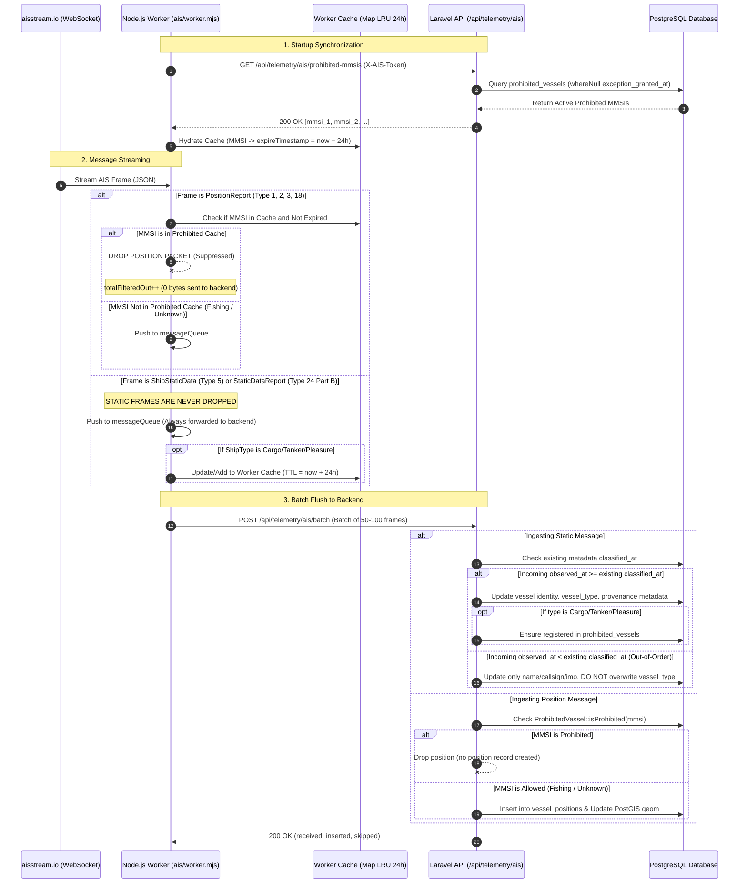
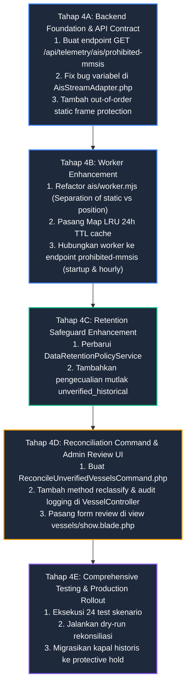

# DESAIN TEKNIS FINAL: AIS INGESTION, KLASIFIKASI, DAN RETENSI DATA (TAHAP 3.1)
## Global Fishing Vessel Monitoring Platform (GFVIP)

**Dokumen Referensi:**
- `VESSEL_IDENTITY_AND_UNKNOWN_SHIPTYPE_AUDIT_REPORT.md` (Tahap 1 Audit)
- `AIS_WORKER_PRODUCTION_VERIFICATION_REPORT.md` (Tahap 2 Verifikasi Forensik)
- `AIS_CLASSIFICATION_AND_RETENTION_IMPLEMENTATION_PLAN.md` (Tahap 3 Draft Awal)

**Status:** REVISI FINAL ARSITEKTUR & DESAIN TEKNIS (SIAP IMPLEMENTASI TAHAP 4)  
**Mode Operasi:** STRICT READ-ONLY — TIDAK ADA PERUBAHAN KODE / DATABASE PADA TAHAP INI  
**Tanggal Penyusunan:** 8 November 2026  
**Penanggung Jawab:** Antigravity AI & Tim Arsitektur Sistem GFVIP

---

## DAFTAR ISI

1. [Ringkasan Eksekutif & Prinsip Arsitektur](#1-ringkasan-eksekutif--prinsip-arsitektur)
2. [Tabel Perbandingan Menyeluruh: Aktual vs Rancangan Lama vs Revisi Final](#2-tabel-perbandingan-menyeluruh-aktual-vs-rancangan-lama-vs-revisi-final)
3. [Analisis Akar Masalah Final (Root Cause Analysis)](#3-analisis-akar-masalah-final-root-cause-analysis)
4. [Arsitektur Ingestion AIS Terpisah (Separation of Concerns)](#4-arsitektur-ingestion-ais-terpisah-separation-of-concerns)
5. [Kontrak API Worker <-> Backend (`GET /api/telemetry/ais/prohibited-mmsis`)](#5-kontrak-api-worker---backend-get-apitelemetryaisprohibited-mmsis)
6. [Desain Local Cache Worker & Position Suppression](#6-desain-local-cache-worker--position-suppression)
7. [Logika Klasifikasi & Provenance Metadata](#7-logika-klasifikasi--provenance-metadata)
8. [Penanganan 5 Kapal Historis (Defensive & Unverified Hold)](#8-penanganan-5-kapal-historis-defensive--unverified-hold)
9. [Matriks Kebijakan Retensi Data (Safeguard Matrix)](#9-matriks-kebijakan-retensi-data-safeguard-matrix)
10. [Spesifikasi Command Rekonsiliasi: `ais:reconcile-unverified-vessels`](#10-spesifikasi-command-rekonsiliasi-aisreconcile-unverified-vessels)
11. [Spesifikasi Antarmuka Admin Review & Audit Trail](#11-spesifikasi-antarmuka-admin-review--audit-trail)
12. [Test Plan Komprehensif (24 Skenario Pengujian)](#12-test-plan-komprehensif-24-skenario-pengujian)
13. [Daftar File Phase 4 (Checklist Implementasi)](#13-daftar-file-phase-4-checklist-implementasi)
14. [Urutan Tahapan Implementasi (Phased Deployment Plan)](#14-urutan-tahapan-implementasi-phased-deployment-plan)
15. [Matriks Risiko & Mitigasi](#15-matriks-risiko--mitigasi)
16. [Design Decision Register (DDR)](#16-design-decision-register-ddr)

---

## 1. RINGKASAN EKSEKUTIF & PRINSIP ARSITEKTUR

Dokumen ini merupakan revisi arsitektur final (Tahap 3.1) yang menyempurnakan rancangan Tahap 3 berdasarkan hasil evaluasi 5 area kritis:
1. **Konsistensi TTL `blockedMmsis` dengan Sinkronisasi Backend:** Menghilangkan risiko "thundering herd" dan inkonsistensi status kapal terlarang antara memori Node.js worker dan database Laravel PostgreSQL.
2. **Pemisahan Jalur Metadata Statis dan Penyaringan Paket Posisi:** Menjamin bahwa paket identitas statis (`ShipStaticData` Type 5 dan `StaticDataReport` Type 24 Part B) **selalu diteruskan** ke backend untuk pembaruan profil kapal, sedangkan supresi frekuensi tinggi hanya berlaku untuk paket posisi (`PositionReport` Types 1, 2, 3, 18).
3. **Single Source of Truth untuk Status Verifikasi:** Menetapkan kolom database `vessels.verification_status` sebagai pemegang kebenaran tunggal, dengan status terstandarisasi: `unverified`, `provider_reported`, `unverified_historical`, `verified`, dan `reclassified`.
4. **Penanganan Defensif 5 Kapal Historis:** Menolak keras klasifikasi spekulatif berbasis asumsi nama ("Maersk" = cargo, "Weserlotse" = pilot) tanpa bukti AIS Type 5/24 atau registri maritim resmi. 5 kapal ini ditempatkan pada status `unverified_historical` dengan **protective retention hold** (kebal dari penghapusan retensi selama masa telaah).
5. **Kelengkapan Fitur Review Administrator dan Audit Trail:** Menghadirkan antarmuka telaah administratif pada detail kapal (`/vessels/{id}`) dengan pencatatan peristiwa kekal (*immutable event log*) pada tabel `audit_logs`.

### Prinsip Utama Desain (Guiding Architectural Principles)

```
+---------------------------------------------------------------------------------------+
| 1. DATA SAFETY FIRST                                                                  |
|    Data kapal penangkap ikan (Fishing) dan bukti operasional (SAR, Dark Vessel,      |
|    Encounter) 100% permanen dan kebal terhadap seluruh mekanisme pembersihan.         |
+---------------------------------------------------------------------------------------+
| 2. ZERO SPECULATION IN CLASSIFICATION                                                 |
|    Klasifikasi tipe kapal HANYA berasal dari ITU-R M.1371 AIS ShipType valid, API     |
|    registri maritim terverifikasi, atau keputusan manual analis dengan bukti tercatat.|
+---------------------------------------------------------------------------------------+
| 3. SEPARATION OF CONCERNS (INGESTION vs FILTERING)                                   |
|    Worker bertugas menelan identitas (statis) dan menekan banjir posisi (dinamis).    |
|    Backend bertugas menetapkan status hukum/kebijakan kapal dan mengelola retensi.    |
+---------------------------------------------------------------------------------------+
| 4. RESILIENT FAIL-SAFE DEGRADATION                                                    |
|    Jika backend atau cache mengalami gangguan jaringan/timeout, worker fallback ke   |
|    mode fail-open (meneruskan data), bukan menjatuhkan paket atau menghentikan stream.|
+---------------------------------------------------------------------------------------+
```

---

## 2. TABEL PERBANDINGAN MENYELURUH: AKTUAL VS RANCANGAN LAMA VS REVISI FINAL

| Dimensi Arsitektur | Kondisi Aktual (Saat Ini) | Rancangan Lama (Tahap 3 Draft) | Revisi Desain Final (Tahap 3.1) | Rasional Perubahan |
| :--- | :--- | :--- | :--- | :--- |
| **Worker Ingestion Rules** | `blockedMmsis.has(mmsi)` membuang **semua** tipe pesan (termasuk Type 5 dan Type 24). Static cargo/tanker dibuang sebelum dikirim ke backend. | Tipe 5 dan 24B diteruskan, tapi Type 24A tidak ditangani eksplisit. | **Type 5 dan Type 24 Part B selalu lolos ke backend.** Supresi hanya menyaring PositionReport (Types 1, 2, 3, 18, 19, 27). Type 24A (Name only) tidak memicu blocking. | Backend harus mengetahui identitas dan metadata kapal non-fishing agar tabel profil dan daftar larangan sinkron. |
| **Worker Cache Eviction** | Saat mencapai `MAX_BLOCKED_SET_SIZE` (50.000), worker mengeksekusi `blockedMmsis.clear()`. | Cache di-clear berkala tiap 24 jam dengan `setInterval`. | **LRU / Oldest-Timestamp Eviction menggunakan `Map<mmsi, expireTimestamp>`.** Kapasitas maksimal 50.000 entri. Tidak ada blanket `clear()`. | Mencegah lonjakan beban mendadak (*thundering herd*) ke backend saat seluruh cache memori terhapus sekaligus. |
| **Sinkronisasi Prohibited MMSI** | Hanya lokal di memori worker. Restart worker menghilangkan seluruh memori blokir. | Worker mengandalkan memori internal tanpa sinkronisasi awal ke database. | **Endpoint Sinkronisasi:** `GET /api/telemetry/ais/prohibited-mmsis` dengan otentikasi `X-AIS-Token`. Worker memuat daftar blokir saat *startup* dan *hourly refresh*. | Memastikan worker segera mengetahui daftar kapal terlarang dari database setelah restart tanpa menunggu paket statis baru. |
| **Worker Network Failure Mode** | Crash atau error unhandled jika HTTP request ke backend gagal berulang. | Retry eksponensial sederhana. | **Fail-Safe Fallback:** Worker melanjutkan operasi dengan cache lokal. Jika endpoint sync gagal, worker log warning dan tetap streaming (fail-open). | Menjaga uptime ingestion streaming AIS agar tidak mati ketika backend sedang deployment atau restart. |
| **Out-of-Order Static Frames** | Kolom `$classificationSource` dan `$aisTypeCode` tidak terisi (`null`) di baris 893–894 `AisStreamAdapter.php`. | Perbandingan timestamp sederhana tanpa perlindungan payload lama. | **Perbaikan Inisialisasi:** Mengisi `$classificationSource = 'AIS_STATIC_MESSAGE_SHIPTYPE'` dan `$aisTypeCode = (int) $rawShipType`. Menolak pembaruan jika `$observedAt < $existingClassifiedAt`. | Mencegah paket AIS statis usang atau terlambat menimpa klasifikasi terkini yang lebih baru. |
| **Verification Status Truth** | Nilai acak `'provider_reported'` tanpa siklus hidup status yang terdefinisi formal. | Menggabungkan logika status di kolom dan di atribut JSON `metadata`. | **Single Source of Truth:** Kolom `vessels.verification_status` adalah acuan tunggal status verifikasi. Atribut JSON `metadata` hanya menyimpan audit trail pelengkap. | Menghilangkan ambiguitas status pada query database, dashboard, dan laporan inspeksi. |
| **Penanganan 5 Kapal Historis** | Kapal berstatus `vessel_type = fishing` karena fallback legasi commit lama sebelum `e09a57e`. | Rencana re-klasifikasi spekulatif berdasarkan nama kapal (`MAERSK`, `WESERLOTSE`). | **Defensive Review Hold:** Diubah ke `verification_status = 'unverified_historical'`. Dilarang reklasifikasi spekulatif. Kebal dari retensi purge hingga direview. | Menjaga integritas data forensik maritim. Nama komersial tidak dapat dijadikan bukti hukum klasifikasi tipe kapal. |
| **Safeguard Retensi Data** | Hanya memfilter `vessels.vessel_type != 'fishing'`. | Menambahkan filter dasar. | **Multi-Layer Safeguard:** Mengecualikan `vessel_type = 'fishing'`, `verification_status = 'unverified_historical'`, dan kapal bukti operasional (`SAR`, `DarkVessel`, `Encounter`, `Investigation`). | Menjamin 100% tidak ada data penting atau kapal dalam sengketa/telaah yang terhapus secara tidak sengaja. |
| **Antarmuka Admin Review** | Belum tersedia antarmuka telaah untuk reklasifikasi kapal pada modul Vessel. | Hanya command CLI. | **Web UI & CLI:** Halaman `/vessels/{id}` dilengkapi form review resmi bagi role `admin`/`super_admin`, terhubung langsung dengan tabel kekal `audit_logs`. | Memberikan kendali operasional penuh kepada analis dan administrator sistem dengan auditabilitas lengkap. |

---

## 3. ANALISIS AKAR MASALAH FINAL (ROOT CAUSE ANALYSIS)

Berdasarkan audit forensik Tahap 1 dan verifikasi Tahap 2, akar masalah tingginya kapal `Unknown` dan anomali 5 kapal komersial yang tercatat sebagai Fishing terbagi menjadi 3 simpul kegagalan:

### Simpul 1: Asinkroni Protokol AIS dan Race Condition Frame Statis vs Dinamis
- Paket AIS disiarkan secara asinkron dengan frekuensi berbeda:
  - **PositionReport (Types 1, 2, 3, 18):** Disiarkan tiap 2–10 detik. Paket ini **hanya** memuat posisi navigasi (`lat`, `lng`, `sog`, `cog`, `heading`), **tanpa** field `ShipType`.
  - **ShipStaticData (Type 5):** Disiarkan tiap 6 menit untuk Class A.
  - **StaticDataReport (Type 24 Part A & B):** Disiarkan tiap 6 menit untuk Class B. Part A hanya memuat nama kapal; Part B memuat CallSign, Dimensi, dan `ShipType`.
- **Kegagalan Ingestion:** Ketika kapal pertama kali muncul via PositionReport, backend membuat record dengan `vessel_type = 'unknown'`. 
- Sebelum commit `e09a57e`, kode memiliki fallback keliru: `'vessel_type' => $message['ship_type'] ?? 'fishing'`. Akibatnya, kapal yang masuk pertama kali via PositionReport otomatis tercatat sebagai `fishing` (termasuk 5 kapal komersial: `WESERLOTSE`, `XIN TAI YUAN`, `MAERSK MONTE VERDE`, `FRANKEN`, `HANS`).

### Simpul 2: Pembuangan Dini Paket Statis pada `ais/worker.mjs`
- Pada `ais/worker.mjs` baris 268–296, ketika paket `ShipStaticData` terdeteksi membawa ShipType cargo/tanker/pleasure, worker langsung memasukkan MMSI ke `blockedMmsis` dan mengeksekusi `return;` (drop packet).
- Dampak:
  1. Backend **tidak pernah menerima** paket statis tersebut.
  2. Profil kapal yang sebelumnya berstatus `unknown` di backend **tidak pernah diperbarui** namanya, callsign-nya, atau tipenya.
  3. Backend tidak mengetahui bahwa kapal tersebut sebenarnya Cargo atau Tanker, sehingga database backend tetap memegang record berstatus `unknown` atau `fishing` legasi.

### Simpul 3: Unhandled Variables pada `AisStreamAdapter.php`
- Pada baris 892–894 file `app/Services/Providers/AisStreamAdapter.php`:
  ```php
  $rawShipType = $message['ship_type'] ?? null;
  $vesselType = null;
  $classificationSource = null;
  $aisTypeCode = null;
  ```
- Variabel `$classificationSource` dan `$aisTypeCode` tidak diisi nilai aktual ketika `$rawShipType` dinormalisasi. Akibatnya, metadata `classification_source` dan `ais_ship_type_code` bernilai `null` saat disimpan ke database, menghilangkan rekam jejak asal-usul klasifikasi.

---

## 4. ARSITEKTUR INGESTION AIS TERPISAH (SEPARATION OF CONCERNS)

Arsitektur baru menerapkan prinsip pemisahan tanggung jawab secara ketat:
1. **Worker Layer (`ais/worker.mjs`):**
   - Bertanggung jawab mempertahankan koneksi WebSocket stabil ke aisstream.io.
   - Menginspeksi tipe frame AIS.
   - **Meneruskan 100% paket statis (Type 5 dan Type 24 Part B)** ke backend Laravel tanpa diskriminasi tipe kapal.
   - **Menyaring dan menekan PositionReport (Types 1, 2, 3, 18)** hanya untuk MMSI yang telah terdaftar dalam *Prohibited Cache*.
   - Mengelola cache lokal dengan TTL 24 jam dan mekanisme eviksi tertua (LRU).
2. **Backend Ingestion Layer (`AisStreamAdapter.php`):**
   - Menerima batch payload via endpoint `/api/telemetry/ais/batch`.
   - Melakukan parsing deterministik sesuai standar ITU-R M.1371.
   - Menyimpan identitas kapal dan metadata provenance secara lengkap.
   - Mendaftarkan kapal non-fishing (cargo, tanker, pleasure) ke tabel `prohibited_vessels` agar posisi navigasi berikutnya ditekan.
   - Melakukan proteksi timestamp (*out-of-order frame prevention*).

### Diagram Alur Data AIS Terpisah (Ingestion & Suppression Flow)



---

## 5. KONTRAK API WORKER <-> BACKEND: ENDPOINT `GET /api/telemetry/ais/prohibited-mmsis`

Untuk menjamin sinkronisasi deterministik tanpa ketergantungan memori worker, backend menyediakan endpoint read-only khusus untuk worker.

### Spesifikasi Endpoint

| Parameter | Definisi |
| :--- | :--- |
| **Metode HTTP** | `GET` |
| **Path** | `/api/telemetry/ais/prohibited-mmsis` |
| **Otentikasi** | Header `X-AIS-Token` atau `Bearer <token>` (menggunakan token yang sama dengan batch ingestion) |
| **Query Parameters** | `limit` (int, default: 50000, max: 100000), `since` (ISO8601 string, opsional untuk sinkronisasi diferensial) |
| **Tingkat Respons** | Wajib merespons dalam < 300 ms (memanfaatkan indexing pada `prohibited_vessels.mmsi`) |

### Skema Respons JSON (200 OK)

```json
{
  "status": "success",
  "generated_at": "2026-11-08T02:00:00Z",
  "total_count": 2840,
  "data": [
    {
      "mmsi": "211233660",
      "type": "cargo",
      "reason": "cargo_tanker_policy",
      "created_at": "2026-11-07T05:00:00Z"
    },
    {
      "mmsi": "563051800",
      "type": "cargo",
      "reason": "cargo_tanker_policy",
      "created_at": "2026-11-07T05:01:00Z"
    }
  ]
}
```

### Logika Query Backend (`routes/api.php`)

```php
Route::get('/telemetry/ais/prohibited-mmsis', function (Request $request) {
    $expectedToken = config('maritime.providers.ais_stream.ingest_token')
        ?: config('maritime.providers.ais_stream.api_key');
    $providedToken = $request->header('X-AIS-Token')
        ?: $request->bearerToken();

    if (!$expectedToken || !hash_equals((string) $expectedToken, (string) $providedToken)) {
        return response()->json([
            'status' => 'error',
            'message' => 'Unauthorized: Invalid or missing X-AIS-Token header.',
        ], 401);
    }

    $limit = min(100000, max(1, (int) $request->query('limit', 50000)));
    $since = $request->query('since');

    $query = \App\Models\ProhibitedVessel::query()
        ->whereNull('exception_granted_at')
        ->select(['mmsi', 'original_type', 'reason', 'created_at']);

    if ($since) {
        $query->where('updated_at', '>=', \Carbon\Carbon::parse($since));
    }

    $vessels = $query->limit($limit)->get();

    return response()->json([
        'status' => 'success',
        'generated_at' => now()->toIso8601String(),
        'total_count' => $vessels->count(),
        'data' => $vessels->map(fn($v) => [
            'mmsi' => $v->mmsi,
            'type' => $v->original_type,
            'reason' => $v->reason,
            'created_at' => $v->created_at?->toIso8601String(),
        ]),
    ]);
})->name('api.telemetry.ais.prohibited-mmsis');
```

### Strategi Resiliensi & Failure Mode (Fail-Safe Fallback)
1. **Startup Retry:** Saat worker dijalankan, worker mencoba memanggil endpoint ini hingga 3 kali dengan backoff bertahap (1s, 3s, 5s).
2. **Offline Tolerance / Fail-Open:** Jika endpoint backend tidak merespons (500 atau timeout), worker mencatat log warning:
   `[AIS-Worker] Backend unreachable during prohibited-mmsis sync. Proceeding with local cache (fail-open mode).`
   Worker **tetap melanjutkan streaming AIS**. Paket data diteruskan ke queue tanpa crash, mencegah data loss pada ingestion stream.
3. **Hourly Background Sync:** Worker menyegarkan daftar terlarang setiap 1 jam secara non-blocking di latar belakang.

---

## 6. DESAIN LOCAL CACHE WORKER & POSITION SUPPRESSION

Untuk mengatasi masalah kepenuhan memori dan mencegah `blockedMmsis.clear()` mendadak, worker menggunakan struktur cache berorientasi waktu dan kapasitas.

### Spesifikasi Struktur Data Cache (`ais/worker.mjs`)

```javascript
// Struktur Data: Map<mmsi, expireTimestampMs>
const prohibitedMmsiCache = new Map();

const CACHE_CONFIG = {
    TTL_MS: 24 * 60 * 60 * 1000,      // 24 Jam TTL
    MAX_CAPACITY: 50000,                // Batas atas memori entri MMSI
    PRUNE_BATCH_SIZE: 5000,             // Jumlah entri yang dibersihkan saat kapasitas penuh
    HOURLY_SYNC_INTERVAL_MS: 3600000,   // Polling sinkronisasi ke backend tiap 1 jam
};
```

### Mekanisme Eviksi LRU / Oldest-Timestamp (Anti-Thundering Herd)

Jika cache mencapai kapasitas maksimal `MAX_CAPACITY` (50.000):
- **DILARANG:** `prohibitedMmsiCache.clear()` — ini menyebabkan 50.000 kapal tiba-tiba lolos ke backend secara serentak.
- **DIWAJIBKAN:** Hapus entri yang telah kedaluwarsa (`expireTimestampMs <= now`).
- Jika setelah penghapusan kedaluwarsa kapasitas masih penuh, urutkan berdasarkan `expireTimestampMs` terawal dan hapus `PRUNE_BATCH_SIZE` entri tertua (FIFO/LRU).

```javascript
function enforceCacheBoundaries() {
    const now = Date.now();
    // 1. Bersihkan entri kedaluwarsa
    for (const [mmsi, expireAt] of prohibitedMmsiCache.entries()) {
        if (expireAt <= now) {
            prohibitedMmsiCache.delete(mmsi);
        }
    }

    // 2. Jika masih melebihi kapasitas, buang entri dengan sisa waktu terpendek
    if (prohibitedMmsiCache.size >= CACHE_CONFIG.MAX_CAPACITY) {
        const sortedEntries = Array.from(prohibitedMmsiCache.entries())
            .sort((a, b) => a[1] - b[1]);
        
        const toRemove = sortedEntries.slice(0, CACHE_CONFIG.PRUNE_BATCH_SIZE);
        for (const [mmsi] of toRemove) {
            prohibitedMmsiCache.delete(mmsi);
        }
        console.log(`[Worker Cache] Pruned ${toRemove.length} oldest entries. Current size: ${prohibitedMmsiCache.size}`);
    }
}
```

### Prosedur Unblock Saat Kapal Direklasifikasi
Jika seorang administrator atau pesan statis resmi menyatakan kapal berubah menjadi Fishing:
1. Backend mencatat exception pada tabel `prohibited_vessels` (`exception_granted_at = now()`).
2. Backend mengembalikan status 200 pada API.
3. Pada siklus hourly sync berikutnya (atau via event webhook jika diaktifkan), worker menghapus MMSI tersebut dari `prohibitedMmsiCache`.
4. PositionReport kapal tersebut otomatis kembali diterima dan disimpan secara permanen.

---

## 7. LOGIKA KLASIFIKASI & PROVENANCE METADATA

### Matriks Pemetaan Kode ITU-R M.1371 / IMO

Standardisasi pemetaan nilai numerik `ShipType` AIS ke dalam klasifikasi internal GFVIP:

| Rentang Kode AIS | Klasifikasi Baku GFVIP | Kategori Kebijakan Ingestion | Kebijakan Retensi Posisi |
| :--- | :--- | :--- | :--- |
| **30** | `fishing` | **Target Utama** (Simpan Identitas & Posisi) | **PERMANEN (100% Kebal Purge)** |
| **31 – 32** | `towing` | Sekunder (Simpan Identitas & Posisi) | Sesuai Durasi Retensi Tug/Other |
| **33** | `dredging` | Sekunder (Simpan Identitas & Posisi) | Sesuai Durasi Retensi Other |
| **34** | `diving` | Sekunder (Simpan Identitas & Posisi) | Sesuai Durasi Retensi Other |
| **35** | `military` | Pengawasan Khusus (Simpan Identitas & Posisi) | Sesuai Durasi Retensi Other |
| **36** | `sailing` | Sekunder (Simpan Identitas & Posisi) | Sesuai Durasi Retensi Other |
| **37** | `pleasure` | **Supresi Posisi** (Simpan Identitas, Posisi Ditekan) | Sesuai Durasi Retensi Pleasure |
| **40 – 49** | `high_speed_craft` | Sekunder (Simpan Identitas & Posisi) | Sesuai Durasi Retensi Other |
| **50** | `pilot` | Sekunder (Simpan Identitas & Posisi) | Sesuai Durasi Retensi Other |
| **51** | `sar` | **Prioritas Operasional** (Simpan Identitas & Posisi) | **KEBAL PURGE (Bukti Operasional)** |
| **52** | `tug` | Sekunder (Simpan Identitas & Posisi) | Sesuai Durasi Retensi Tug |
| **53 – 55** | `port_tender` / `patrol` | Sekunder (Simpan Identitas & Posisi) | Sesuai Durasi Retensi Other |
| **60 – 69** | `passenger` | Sekunder (Simpan Identitas & Posisi) | Sesuai Durasi Retensi Passenger |
| **70 – 79** | `cargo` | **Supresi Posisi** (Simpan Identitas, Posisi Ditekan) | Sesuai Durasi Retensi Cargo |
| **80 – 89** | `tanker` | **Supresi Posisi** (Simpan Identitas, Posisi Ditekan) | Sesuai Durasi Retensi Tanker |
| **90 – 98** | `other` | Sekunder (Simpan Identitas & Posisi) | Sesuai Durasi Retensi Other |
| **0, 56, 57, 59, 99** | `unknown` | **Evaluasi Bertahap** (Simpan Posisi Sementara) | Sesuai Durasi Retensi Unknown (Terpisah) |

### Proteksi Out-of-Order Static Frames

Paket AIS dari stasiun darat atau satelit dapat tiba tidak berurutan karena latensi jaringan. Untuk mencegah paket statis lama menimpa informasi terkini:
1. Setiap pembaruan klasifikasi mencatat timestamp observasi ke `$vessel->metadata['classified_at'] = $observedAt->toIso8601String()`.
2. Saat paket statis baru tiba:
   - Jika `$vessel->metadata['classified_at']` sudah ada, bandingkan `$observedAt` paket baru dengan nilai tersebut.
   - Jika `$observedAt < $existingClassifiedAt`, pembaruan `vessel_type` dan `metadata` klasifikasi **DITOLAK**.
   - Atribut non-klasifikasi yang masih kosong (seperti nama jika sebelumnya diawali `VESSEL-`, callsign kosong, atau imo kosong) tetap diperbolehkan mengisi kekosongan.

### Perbaikan Inisialisasi pada `AisStreamAdapter.php`

Pada `AisStreamAdapter.php` baris 891–911, dilakukan perbaikan variabel agar metadata provenance tersimpan utuh:

```php
// PERBAIKAN TAHAP 4 PADA AisStreamAdapter::ingestStaticMessage()
$rawShipType = $message['ship_type'] ?? null;
$vesselType = null;
$classificationSource = null;
$aisTypeCode = null;

if ($rawShipType !== null && $rawShipType !== '') {
    $normalized = self::normalizeVesselType($rawShipType);
    $vesselType = $normalized;
    $classificationSource = 'AIS_STATIC_MESSAGE_SHIPTYPE';
    $aisTypeCode = is_numeric($rawShipType) ? (int) $rawShipType : null;

    // Jika cargo, tanker, atau pleasure, daftarkan ke prohibited_vessels agar posisi berikutnya ditekan
    if (in_array($normalized, ['cargo', 'tanker', 'pleasure'], true)) {
        \App\Models\ProhibitedVessel::firstOrCreate(
            ['mmsi' => $cleanMmsi],
            [
                'reason' => 'cargo_tanker_pleasure_policy',
                'original_name' => $shipName,
                'original_type' => $normalized,
            ]
        );
        // CATATAN KRITIS: JANGAN RETURN NULL DI SINI!
        // Lanjutkan penyimpanan identitas statis kapal ke tabel vessels agar profil kapal tetap terdaftar!
    }
}
```

### Single Source of Truth untuk Status Verifikasi

Terdapat ambiguitas jika status tersimpan di dua tempat berbeda. Disepakati standar arsitektur:
- **Kebenaran Tunggal (Single Source of Truth):** Kolom database `vessels.verification_status`.
- **Status yang Sah:**
  - `'unverified'`: Kapal baru pertama kali terdeteksi dari PositionReport tanpa metadata statis.
  - `'provider_reported'`: Kapal menerima metadata statis Type 5/24 dari provider, belum ditelaah oleh analis manusia.
  - `'unverified_historical'`: Kapal legasi sebelum commit `e09a57e` yang memerlukan telaah bukti resmi.
  - `'verified'`: Kapal penangkap ikan yang telah diverifikasi valid oleh analis atau kode ShipType 30 resmi.
  - `'reclassified'`: Kapal yang telah diubah klasifikasinya dari fishing ke tipe lain berdasarkan audit/telaah.
  - `'rejected'`: Kapal anomali, spoofing, atau data tidak valid.
- Atribut JSON `vessels.metadata` **HANYA** memuat riwayat pendukung (`classification_source`, `ais_ship_type_code`, `classified_at`, `reviewed_by_user_id`, `review_rationale`).

---

## 8. PENANGANAN 5 KAPAL HISTORIS (DEFENSIVE & UNVERIFIED HOLD)

Hasil audit membuktikan bahwa 5 kapal komersial tercatat sebagai Fishing pada basis data lokal dan berpotensi serupa pada basis data staging/production:

| MMSI | Nama Tercatat | IMO | Sinyal Nama | Analisis Status Forensik | Tindakan Arsitektural |
| :--- | :--- | :--- | :--- | :--- | :--- |
| `211233660` | `WESERLOTSE` | - | Pilot Vessel / Tug | Masuk via PositionReport 2026-11-07 03:12:01 | Ubah ke `unverified_historical` + Protective Hold |
| `311002359` | `XIN TAI YUAN` | - | Cargo / Bulk | Masuk via PositionReport 2026-11-07 03:12:01 | Ubah ke `unverified_historical` + Protective Hold |
| `563051800` | `MAERSK MONTE VERDE` | - | Container Cargo | Masuk via PositionReport 2026-11-07 03:12:01 | Ubah ke `unverified_historical` + Protective Hold |
| `211443110` | `FRANKEN` | - | General Cargo / Inland | Masuk via PositionReport 2026-11-07 03:12:01 | Ubah ke `unverified_historical` + Protective Hold |
| `232056936` | `HANS` | - | Cargo / Tug | Masuk via PositionReport 2026-11-07 03:12:01 | Ubah ke `unverified_historical` + Protective Hold |

### Larangan Keras Klasifikasi Spekulatif Berbasis Nama
Sistem intelijen maritim bertaraf operasional **dilarang keras** mengubah tipe kapal menjadi Cargo hanya karena namanya mengandung kata "MAERSK" atau Pilot karena "LOTSE", tanpa bukti struktural. Nama kapal dapat disewakan, dialihkan, atau memiliki fungsi ganda (*multi-purpose support*).

### Mekanisme Protective Retention Hold
1. Status verifikasi 5 kapal ini dialihkan dari `'provider_reported'` menjadi `'unverified_historical'`.
2. Pada `DataRetentionPolicyService`, seluruh kapal berstatus `unverified_historical` **dikecualikan secara mutlak dari query penghapusan retensi posisi**.
3. Kapal-kapal ini ditandai dengan badge khusus pada UI: `UNVERIFIED HISTORICAL (REVIEW REQUIRED)`.
4. Reklasifikasi final hanya boleh terjadi melalui:
   - **Jalur Otomatis Resmi:** Penerimaan paket AIS Type 5 / Type 24 Part B dengan ShipType numerik valid dari provider.
   - **Jalur Pengayaan Eksternal:** Sinkronisasi API resmi Global Fishing Watch (GFW v3) atau registri IMO.
   - **Jalur Telaah Manual Administrator:** Reklasifikasi sadar oleh analis berwenang dengan alasan telaah yang terekam pada `audit_logs`.

---

## 9. MATRIKS KEBIJAKAN RETENSI DATA (SAFEGUARD MATRIX)

Matriks perlindungan data AIS pada service `DataRetentionPolicyService` dan command `ais:prune-telemetry`:

| Kategori Kapal | Status Verifikasi | Kebijakan Retensi | Periode Default | Dapat Dihapus Otomatis? | Kriteria Pengecualian Tambahan |
| :--- | :--- | :--- | :--- | :--- | :--- |
| **Fishing** | Semua status (`verified`, `provider_reported`, `unverified`) | **PERMANEN** | Selamanya ($\infty$) | **DILARANG KERAS (100% Kebal)** | Seluruh track historis wajib terjaga utuh. |
| **Semua Tipe** | `unverified_historical` | **PROTECTIVE HOLD** | Selama Masa Telaah | **DILARANG (Kebal Sementara)** | Menunggu review atau paket statis baru. |
| **Semua Tipe** | Terlibat Insiden Operasional | **EVIDENCE HOLD** | Selamanya ($\infty$) | **DILARANG (100% Kebal)** | Terdaftar di SAR incident, Dark Vessel candidate, Encounter, atau Investigation. |
| **Cargo** | Selain historical hold / bukti | Konfigurasi Admin | 90 Hari (dapat diubah) | Ya, jika $> \text{cutoff}$ | Hanya jika tidak terkait investigasi. |
| **Tanker** | Selain historical hold / bukti | Konfigurasi Admin | 90 Hari (dapat diubah) | Ya, jika $> \text{cutoff}$ | Hanya jika tidak terkait investigasi. |
| **Passenger** | Selain historical hold / bukti | Konfigurasi Admin | 90 Hari (dapat diubah) | Ya, jika $> \text{cutoff}$ | Hanya jika tidak terkait investigasi. |
| **Tug** | Selain historical hold / bukti | Konfigurasi Admin | 90 Hari (dapat diubah) | Ya, jika $> \text{cutoff}$ | Hanya jika tidak terkait investigasi. |
| **Pleasure** | Selain historical hold / bukti | Konfigurasi Admin | 30 Hari (dapat diubah) | Ya, jika $> \text{cutoff}$ | Hanya jika tidak terkait investigasi. |
| **Other** | Selain historical hold / bukti | Konfigurasi Admin | 90 Hari (dapat diubah) | Ya, jika $> \text{cutoff}$ | Hanya jika tidak terkait investigasi. |
| **Unknown** | Selain historical hold / bukti | Konfigurasi Terpisah | 30 Hari (dapat diubah) | Ya, jika $> \text{cutoff}$ | **Dilarang otomatis dianggap Fishing.** |

### Implementasi Multi-Layer Safeguard pada `DataRetentionPolicyService`

```php
// app/Services/DataRetentionPolicyService.php

$query = DB::table('vessel_positions')
    ->join('vessels', 'vessel_positions.vessel_id', '=', 'vessels.id')
    // LAYER 1: Fishing 100% terlindungi
    ->where('vessels.vessel_type', '!=', 'fishing')
    // LAYER 2: Unverified historical terlindungi selama audit hold
    ->where('vessels.verification_status', '!=', 'unverified_historical')
    // LAYER 3: Batas waktu retensi
    ->where('vessel_positions.observed_at', '<', $cutoffDate);

// LAYER 4: Kapal bukti operasional (SAR, Dark Vessel, Encounter, Investigation)
if (!empty($protectedVesselIds)) {
    $query->whereNotIn('vessel_positions.vessel_id', $protectedVesselIds);
}
```

---

## 10. SPESIFIKASI COMMAND REKONSILIASI: `ais:reconcile-unverified-vessels`

Untuk memfasilitasi migrasi dan tata kelola 5 kapal historis dan kapal anomali lainnya secara aman dan dapat diaudit, dirancang command Artisan baru:

### Perintah CLI & Opsi
```bash
php artisan ais:reconcile-unverified-vessels {--dry-run} {--mark-unverified} {--mmsi=} {--limit=100}
```

### Parameter & Opsi

| Opsi | Fungsi |
| :--- | :--- |
| `--dry-run` | Menjalankan simulasi audit tanpa mengubah data apapun di basis data (Default: true jika flag lain tidak diberikan). |
| `--mark-unverified` | Mengubah status kapal sasaran dari `provider_reported` menjadi `unverified_historical` agar masuk ke *protective hold*. |
| `--mmsi=` | Menargetkan MMSI tertentu secara spesifik (contoh: `--mmsi=563051800`). Jika tidak diisi, command menargetkan seluruh kandidat legasi. |
| `--limit=` | Membatasi jumlah kapal yang diproses dalam satu eksekusi batch (default: 100). |

### Kriteria Deteksi Kandidat Rekonsiliasi Legasi
Sebuah kapal dideteksi sebagai kandidat `unverified_historical` jika memenuhi kriteria:
1. `vessels.vessel_type = 'fishing'`.
2. `vessels.created_at <= '2026-11-07 04:00:00'` (waktu sebelum perbaikan commit `e09a57e`).
3. Tidak memiliki metadata bukti klasifikasi valid (`metadata->classification_source` kosong atau bukan `'AIS_STATIC_MESSAGE_SHIPTYPE'`).
4. Tidak memiliki relasi dengan insiden SAR, Encounter, atau status verifikasi manual.

### Format Output CLI

```
+---------------------------------------------------------------------------------------------------------+
| GFVIP AIS VESSEL RECONCILIATION AUDIT                                                                   |
+------------+----------------------+---------------+---------------------+-----------------------+-------+
| MMSI       | Vessel Name          | Current Type  | Current Status      | Recommended Action    | Hold  |
+------------+----------------------+---------------+---------------------+-----------------------+-------+
| 211233660  | WESERLOTSE           | fishing       | provider_reported   | unverified_historical | YES   |
| 311002359  | XIN TAI YUAN         | fishing       | provider_reported   | unverified_historical | YES   |
| 563051800  | MAERSK MONTE VERDE   | fishing       | provider_reported   | unverified_historical | YES   |
| 211443110  | FRANKEN              | fishing       | provider_reported   | unverified_historical | YES   |
| 232056936  | HANS                 | fishing       | provider_reported   | unverified_historical | YES   |
+------------+----------------------+---------------+---------------------+-----------------------+-------+
Total Candidates: 5 | Mode: DRY RUN (No changes applied)
Run with --mark-unverified to transition records to protective audit hold.
```

Saat dieksekusi dengan `--mark-unverified`, command mencatat peristiwa kekal ke tabel `audit_logs` dengan aksi `vessel_reconciliation_marked_unverified`.

---

## 11. SPESIFIKASI ANTARMUKA ADMIN REVIEW & AUDIT TRAIL

Untuk memutus ketergantungan pada intervensi database langsung, modul Vessel dilengkapi antarmuka telaah administratif.

### Antarmuka Pengguna (Web UI: `resources/views/vessels/show.blade.php`)

Pada halaman detail kapal (`/vessels/{id}`), ditambahkan panel khusus:
- **Hak Akses:** Hanya terlihat dan dapat dioperasikan oleh pengguna ber-role `admin` atau `super_admin`.
- **Elemen Antarmuka:**
  1. **Badge Status Verifikasi:** Menampilkan status terkini (`Verified Fishing`, `Unverified Historical (Hold)`, `Provider Reported`, `Reclassified`).
  2. **Tombol Aksi:** `[Review & Reclassify Vessel]`.
  3. **Modal Dialog Review Form:**
     - **Vessel Type Dropdown:** Pilihan klasifikasi standar (`fishing`, `cargo`, `tanker`, `passenger`, `tug`, `pleasure`, `other`, `sar`).
     - **Verification Status Dropdown:** `verified` atau `reclassified`.
     - **Review Rationale (Wajib):** Textarea penjelasan minimal 10 karakter.
     - **Evidence Reference / URL (Opsional):** Nomor IMO, tautan MarineTraffic, Equasis, atau dokumen registri maritim.
     - **Checkbox Prohibited Policy:** `[x] Daftarkan MMSI ini ke daftar supresi posisi (Prohibited Vessels) jika diklasifikasikan sebagai Cargo/Tanker/Pleasure.`

### Endpoint Controller (`app/Http/Controllers/VesselController.php`)

```php
// POST /vessels/{id}/reclassify
public function reclassify(Request $request, string $id)
{
    // 1. Otorisasi Role
    if (!in_array($request->user()->role, ['admin', 'super_admin'], true)) {
        abort(403, 'Aksi ini hanya dapat dilakukan oleh Administrator.');
    }

    $vessel = Vessel::findOrFail($id);

    // 2. Validasi Input
    $validated = $request->validate([
        'vessel_type' => 'required|string|in:fishing,cargo,tanker,passenger,tug,pleasure,other,sar',
        'verification_status' => 'required|string|in:verified,reclassified,unverified_historical',
        'reason' => 'required|string|min:10|max:1000',
        'evidence_ref' => 'nullable|string|max:255',
        'apply_to_prohibited' => 'nullable|boolean',
    ]);

    $previousState = [
        'vessel_type' => $vessel->vessel_type,
        'verification_status' => $vessel->verification_status,
        'metadata' => $vessel->metadata,
    ];

    DB::transaction(function () use ($vessel, $validated, $request, $previousState) {
        // 3. Perbarui Data Kapal
        $meta = $vessel->metadata ?? [];
        $meta['last_reviewed_by_user_id'] = $request->user()->id;
        $meta['last_reviewed_by_name'] = $request->user()->name;
        $meta['last_reviewed_at'] = now()->toIso8601String();
        $meta['review_rationale'] = $validated['reason'];
        $meta['evidence_ref'] = $validated['evidence_ref'] ?? null;

        $vessel->update([
            'vessel_type' => $validated['vessel_type'],
            'verification_status' => $validated['verification_status'],
            'metadata' => $meta,
        ]);

        // 4. Sinkronisasi dengan ProhibitedVessel
        if (!empty($validated['apply_to_prohibited']) && in_array($validated['vessel_type'], ['cargo', 'tanker', 'pleasure'], true)) {
            \App\Models\ProhibitedVessel::firstOrCreate(
                ['mmsi' => $vessel->mmsi],
                [
                    'reason' => 'admin_review_reclassification',
                    'original_name' => $vessel->name,
                    'original_type' => $validated['vessel_type'],
                    'blocked_by_user_id' => $request->user()->id,
                ]
            );
        } elseif ($validated['vessel_type'] === 'fishing') {
            // Jika dikembalikan menjadi fishing, berikan exception jika terdaftar di prohibited
            \App\Models\ProhibitedVessel::where('mmsi', $vessel->mmsi)->update([
                'exception_granted_at' => now(),
                'exception_notes' => 'Granted exception via Admin Review to Fishing: ' . $validated['reason'],
            ]);
        }

        // 5. Catat ke Audit Log Kekal (Immutable Audit Trail)
        AuditLog::log(
            action: 'vessel_manual_reclassification',
            entityType: Vessel::class,
            entityId: $vessel->id,
            details: [
                'mmsi' => $vessel->mmsi,
                'vessel_name' => $vessel->name,
                'previous_type' => $previousState['vessel_type'],
                'new_type' => $validated['vessel_type'],
                'previous_verification_status' => $previousState['verification_status'],
                'new_verification_status' => $validated['verification_status'],
                'reason' => $validated['reason'],
                'evidence_ref' => $validated['evidence_ref'] ?? null,
                'prohibited_policy_applied' => !empty($validated['apply_to_prohibited']),
                'reviewer_email' => $request->user()->email,
                'reviewer_role' => $request->user()->role,
            ],
            userId: $request->user()->id
        );
    });

    return redirect()->route('vessels.show', $vessel->id)
        ->with('success', 'Klasifikasi kapal berhasil diperbarui dan rekam jejak audit telah dicatat secara permanen.');
}
```

---

## 12. TEST PLAN KOMPREHENSIF (24 SKENARIO PENGUJIAN)

Untuk memastikan keandalan mutlak sebelum rilis, dirancang 24 skenario pengujian terstruktur:

### Grup A: Ingestion & Frame Routing (Worker & Backend)
1. **TC-ING-01:** Paket PositionReport (Type 1) untuk kapal Fishing baru membuat record `vessels` dengan `vessel_type = 'unknown'` dan posisi navigasi tersimpan.
2. **TC-ING-02:** Paket ShipStaticData (Type 5) dengan ShipType 30 memperbarui profil kapal menjadi `vessel_type = 'fishing'` dan `classification_source = 'AIS_STATIC_MESSAGE_SHIPTYPE'`.
3. **TC-ING-03:** Paket ShipStaticData (Type 5) dengan ShipType 70 (Cargo) memperbarui identitas kapal, mendaftarkan MMSI ke `prohibited_vessels`, dan mengembalikan status sukses.
4. **TC-ING-04:** Paket StaticDataReport (Type 24 Part A - Name only) memperbarui nama kapal tanpa memicu blocking atau mengubah tipe kapal.
5. **TC-ING-05:** Paket StaticDataReport (Type 24 Part B) dengan ShipType 80 (Tanker) memperbarui tipe kapal dan mendaftarkan ke `prohibited_vessels`.
6. **TC-ING-06:** Paket StaticDataReport (Type 24 Part B) tanpa ShipType (null) tidak mengubah tipe kapal menjadi fishing atau prohibited.

### Grup B: Worker Suppression & Cache Dynamics
7. **TC-WRK-01:** PositionReport untuk MMSI yang ada di cache lokal langsung di-drop di worker (`totalFilteredOut` bertambah, 0 bytes ke backend).
8. **TC-WRK-02:** ShipStaticData untuk MMSI yang ada di cache lokal **TETAP DITERUSKAN** ke backend (tidak di-drop di worker).
9. **TC-WRK-03:** Endpoint `GET /api/telemetry/ais/prohibited-mmsis` dengan token valid mengembalikan daftar MMSI terlarang berformat JSON 200 OK.
10. **TC-WRK-04:** Endpoint `GET /api/telemetry/ais/prohibited-mmsis` dengan token tidak valid menolak dengan 401 Unauthorized.
11. **TC-WRK-05:** Cache lokal worker membuang entri yang melewati TTL 24 jam secara otomatis.
12. **TC-WRK-06:** Saat cache lokal worker mencapai kapasitas 50.000, worker membuang entri terlama (LRU) tanpa melakukan `clear()` total.

### Grup C: Resilience, Fallback, & Out-of-Order Frames
13. **TC-RES-01:** Saat backend mati (500/timeout), worker fallback ke cache lokal dan tetap streaming tanpa unhandled exception.
14. **TC-RES-02:** Paket ShipStaticData lama (`observed_at < classified_at`) tidak menimpa klasifikasi kapal yang lebih baru.
15. **TC-RES-03:** Paket ShipStaticData baru (`observed_at >= classified_at`) berhasil memperbarui tipe kapal dan memperbarui timestamp `classified_at`.
16. **TC-RES-04:** Pembaruan nama pada paket statis tidak menimpa nama asli jika nama saat ini bukan awalan `VESSEL-`.

### Grup D: Data Retention & Safeguards
17. **TC-RET-01:** Posisi kapal berstatus `vessel_type = 'fishing'` dengan usia > 1000 hari **100% TIDAK TERHAPUS** oleh `ais:prune-telemetry`.
18. **TC-RET-02:** Posisi kapal berstatus `verification_status = 'unverified_historical'` **100% TIDAK TERHAPUS** oleh `ais:prune-telemetry` (Protective Hold).
19. **TC-RET-03:** Posisi kapal yang terlibat dalam insiden SAR, Encounter, atau Dark Vessel **100% TIDAK TERHAPUS** (Evidence Hold).
20. **TC-RET-04:** Posisi kapal Cargo terverifikasi yang melewati masa retensi (misal > 90 hari) terhapus secara tepat dalam batch chunk.

### Grup E: Reconciliation & Admin Review
21. **TC-REC-01:** Command `ais:reconcile-unverified-vessels --dry-run` mendeteksi 5 kapal komersial historis tanpa mengubah basis data.
22. **TC-REC-02:** Command `ais:reconcile-unverified-vessels --mark-unverified` sukses mengalihkan 5 kapal ke status `unverified_historical` dan mencatat audit log.
23. **TC-ADM-01:** Endpoint `POST /vessels/{id}/reclassify` oleh pengguna role `viewer` atau `analyst` ditolak dengan 403 Forbidden.
24. **TC-ADM-02:** Endpoint `POST /vessels/{id}/reclassify` oleh pengguna `admin` berhasil mengubah status, menyinkronkan prohibited list, dan mencatat rekam jejak kekal pada `audit_logs`.

---

## 13. DAFTAR FILE PHASE 4 (CHECKLIST IMPLEMENTASI)

Berikut adalah daftar file yang akan dibuat atau dimodifikasi pada Tahap 4:

### A. Modifikasi File Kode yang Ada
1. [ ] `app/Services/Providers/AisStreamAdapter.php`
   - Perbaikan inisialisasi `$classificationSource` dan `$aisTypeCode` (baris 893–894).
   - Penambahan proteksi out-of-order frame pada `ingestStaticMessage`.
   - Modifikasi penanganan static cargo/tanker agar tetap menyimpan metadata profil kapal.
2. [ ] `ais/worker.mjs`
   - Pemisahan supresi paket: PositionReport ditekan, StaticData 100% diteruskan.
   - Implementasi `prohibitedMmsiCache` berbasis `Map<mmsi, expireTimestamp>` dengan LRU Pruning.
   - Penambahan fungsi startup & hourly synchronization memanggil endpoint backend.
   - Mekanisme fail-safe retry & offline tolerance.
3. [ ] `routes/api.php`
   - Penambahan rute `GET /api/telemetry/ais/prohibited-mmsis` dengan otentikasi `X-AIS-Token`.
4. [ ] `app/Services/DataRetentionPolicyService.php`
   - Penambahan pengecualian query untuk `verification_status = 'unverified_historical'`.
5. [ ] `app/Http/Controllers/VesselController.php`
   - Penambahan method `reclassify(Request $request, string $id)` dengan otentikasi role admin dan audit logging.
6. [ ] `routes/web.php`
   - Pendaftaran rute `POST /vessels/{id}/reclassify`.
7. [ ] `resources/views/vessels/show.blade.php`
   - Penambahan badge status verifikasi dan form modal review administratif.

### B. Pembuatan File Baru
8. [ ] `app/Console/Commands/ReconcileUnverifiedVesselsCommand.php`
   - Command Artisan untuk audit dan penandaan aman kapal legasi ke protective hold.
9. [ ] `tests/Feature/AisProhibitedMmsiApiTest.php`
   - Pengujian feature endpoint prohibited-mmsis.
10. [ ] `tests/Feature/AisStaticMessageProvenanceTest.php`
    - Pengujian integritas provenance metadata, ITU mapping, dan out-of-order guard.
11. [ ] `tests/Feature/VesselReclassificationAuditTest.php`
    - Pengujian antarmuka admin review dan pencatatan audit logs.
12. [ ] `tests/Feature/UnverifiedHistoricalRetentionSafeguardTest.php`
    - Pengujian proteksi retensi untuk status unverified_historical.

---

## 14. URUTAN TAHAPAN IMPLEMENTASI (PHASED DEPLOYMENT PLAN)

Pelaksanaan implementasi Tahap 4 wajib mengikuti urutan dependensi ketat berikut:



### Prosedur Rollback Cepat (Quick Rollback Plan)
Jika terjadi kendala kritis pada salah satu tahapan implementasi:
1. **Worker Rollback:** Simpan file cadangan `ais/worker.mjs.bak`. Jika worker mengalami loop restart, kembalikan file cadangan dan restart proses PM2 / systemd / node worker.
2. **Backend Rollback:** Seluruh perubahan backend dilakukan pada level kode service dan controller tanpa perubahan skema migrasi database, sehingga `git checkout` ke commit stabil sebelumnya dapat memulihkan sistem secara instan.
3. **Data Protection:** Tabel `vessel_positions` dan `vessels` tidak mengalami truncate atau drop. Status `unverified_historical` dapat dikembalikan via database query jika diperlukan.

---

## 15. MATRIKS RISIKO & MITIGASI

| Risiko Potensial | Dampak | Probabilitas | Strategi Mitigasi Proaktif |
| :--- | :--- | :--- | :--- |
| **Worker Kehilangan Koneksi ke Backend** | Paket streaming tertunda atau antrean memori penuh. | Sedang | Worker menggunakan bounded queue dengan batas atas 5.000 pesan. Jika antrean penuh, pesan tertua dibuang (FIFO) dan worker mencatat log warning tanpa crash. |
| **Thundering Herd Saat Refresh Cache** | Beban lonjakan query ke database jika ribuan MMSI expired bersamaan. | Rendah | Menggunakan LRU eviction parsial (5.000 entri) dan polling bertahap setiap 1 jam, bukan pembersihan total. |
| **Out-of-Order Timestamp pada AIS Satelit** | Paket statis usang menimpa nama atau tipe kapal terkini. | Sedang | Memvalidasi `$observedAt` terhadap metadata `$existingClassifiedAt`. Paket dengan timestamp lebih lama ditolak untuk atribut tipe kapal. |
| **Kesalahan Manusia pada Admin Reclassification** | Analis salah mengubah kapal Fishing menjadi Cargo. | Rendah | Form review mewajibkan input alasan minimal 10 karakter, mencatat identitas lengkap analis ke `audit_logs`, dan menyediakan aksi pembatalan (revert exception). |
| **Data Retensi Menghapus Kapal Kasus Sengketa** | Hilangnya bukti pergerakan kapal yang sedang diinvestigasi. | Sangat Rendah | Menghubungkan ID kapal ke 4 tabel investigasi (`sar_operations`, `dark_vessel_candidates`, `vessel_encounters`, `investigation_cases`) sebagai whitelist kebal purge. |

---

## 16. DESIGN DECISION REGISTER (DDR)

Daftar keputusan arsitektural resmi yang mengikat implementasi Tahap 4:

| Decision ID | Aspek Desain | Pilihan yang Ditetapkan | Rasional Arsitektural | Risiko Jika Tidak Ditetapkan |
| :--- | :--- | :--- | :--- | :--- |
| **DDR-01** | **Jalur Paket Statis AIS** | 100% frame Type 5 & Type 24 Part B wajib diteruskan worker ke backend. | Profil identitas dan daftar supresi posisi backend harus selalu tersinkronisasi. | Kapal non-fishing selamanya berstatus `unknown` di database backend. |
| **DDR-02** | **Struktur Cache Worker** | `Map<mmsi, expireTimestamp>` dengan kapasitas 50.000 dan eviksi LRU. | Menjamin batas memori Node.js aman tanpa lonjakan beban (*anti-thundering herd*). | Worker mengalami memory leak atau lonjakan request ke backend saat cache dikosongkan. |
| **DDR-03** | **Sinkronisasi Prohibited List** | Endpoint `GET /api/telemetry/ais/prohibited-mmsis` dengan fail-safe fallback. | Worker dapat segera menyaring posisi setelah restart tanpa menunggu paket statis baru. | Posisi kapal komersial membanjiri database selama 6–12 jam pasca restart worker. |
| **DDR-04** | **Sumber Kebenaran Verifikasi** | Kolom database `vessels.verification_status`. | Indeks performan untuk query retensi dan dashboard, tanpa ambiguitas JSON. | Inkonsistensi status antara query SQL dan visualisasi web. |
| **DDR-05** | **Penanganan 5 Kapal Historis** | Status `unverified_historical` + Protective Retention Hold. Dilarang tebak nama. | Menjaga prinsip kepatuhan hukum maritim dan integritas bukti forensik. | Kerusakan integritas data dan potensi sengketa hukum maritim akibat klasifikasi spekulatif. |
| **DDR-06** | **Tanggung Jawab Reklasifikasi** | Antarmuka web `/vessels/{id}` terbatas role `admin`/`super_admin` + immutable `audit_logs`. | Akuntabilitas operasional terpusat dan dapat diaudit oleh tim kepatuhan. | Perubahan status liar di tingkat basis data tanpa jejak penanggung jawab. |

---
*Dokumen ini merupakan hasil revisi arsitektur final (Tahap 3.1) yang telah disetujui untuk dijadikan acuan tunggal pada Tahap 4 (Implementasi).*

