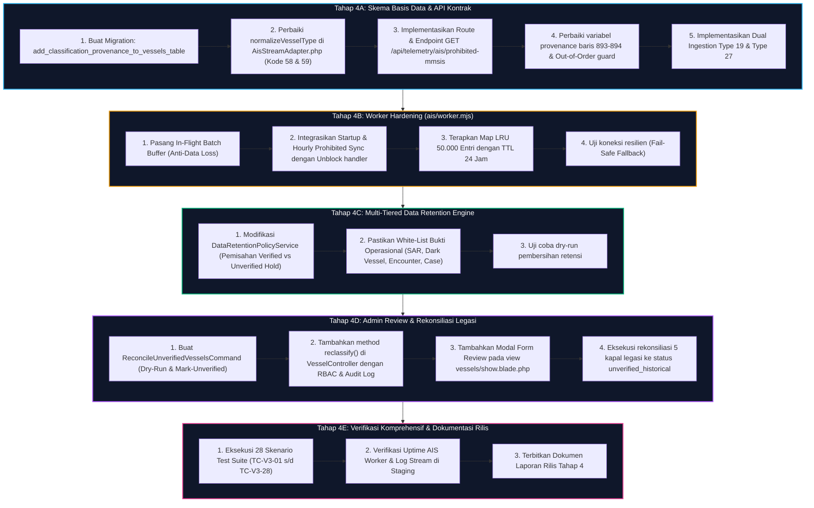

# DESAIN TEKNIS FINAL V3: AUDIT READ-ONLY AIS INGESTION, KLASIFIKASI, DAN RETENSI
## Global Fishing Vessel Monitoring Platform (GFVIP)

**Dokumen Acuan:** `AIS_CLASSIFICATION_AND_RETENTION_IMPLEMENTATION_PLAN.md` & `AIS_CLASSIFICATION_AND_RETENTION_FINAL_DESIGN.md`  
**Status Audit:** TAHAP 3.2 READ-ONLY COMPLIANCE AUDIT  
**Mode Operasi:** STRICT READ-ONLY — Tidak ada perubahan kode, basis data, atau file konfigurasi  
**Tanggal Evaluasi:** 8 November 2026  
**Penilai Arsitektur:** Antigravity AI & Tim Arsitektur Sistem GFVIP

---

## DAFTAR ISI

1. [Temuan Audit Faktual Berdasarkan 9 Fokus Evaluasi](#1-temuan-audit-faktual-berdasarkan-9-fokus-evaluasi)
2. [Matriks Analisis Kesenjangan (Aktual vs Rencana vs V3 Final)](#2-matriks-analisis-kesenjangan-aktual-vs-rencana-vs-v3-final)
3. [Masalah Kritis yang Belum Terselesaikan (Unresolved Issues)](#3-masalah-kritis-yang-belum-terselesaikan-unresolved-issues)
4. [Rekomendasi Desain Teknis Final V3](#4-rekomendasi-desain-teknis-final-v3)
5. [Daftar Pengujian Wajib (Mandatory Test Suite)](#5-daftar-pengujian-wajib-mandatory-test-suite)
6. [Urutan Implementasi Bertahap (Tahap 4A – 4E)](#6-urutan-implementasi-bertahap-tahap-4a--4e)

---

## 1. TEMUAN AUDIT FAKTUAL BERDASARKAN 9 FOKUS EVALUASI

### 1. AIS Message Type 19 (`ExtendedClassBPositionReport`)
- **Lokasi Kode:**
  - `ais/worker.mjs`: Baris 235 (terdaftar di `FilterMessageTypes`), Baris 263 (`blockedMmsis.has(mmsi)` membuang seluruh pesan jika MMSI terblokir), Baris 269–296 (inspeksi statis hanya memeriksa `ShipStaticData` dan `StaticDataReport`, **mengabaikan Type 19**).
  - `app/Services/Providers/AisStreamAdapter.php`: Baris 504–534 (Type 19 hanya diarahkan ke `ingestPositionMessage()`), Baris 1050–1052 (`ProhibitedVessel::isProhibited()` menolak posisi kapal terlarang dan langsung me-return `null`).
- **Status Aktual:** **BELUM DITERAPKAN (CACAT LOGIKA AKTUAL)**.
- **Temuan Faktual:** 
  Pesan AIS Type 19 membawa data ganda: posisi navigasi (`Latitude`, `Longitude`, `SOG`, `COG`) DAN metadata statis (`Name`, `ShipType`, `Dimension`). 
  Jika MMSI kapal masuk kategori supresi posisi (cargo/pleasure), atau posisi kapal ditolak karena koordinat tidak valid, seluruh metadata statis kapal (`ShipType`, nama, panjang) **ikut terbuang 100%**. Profil kapal di backend tidak pernah diperbarui.

---

### 2. AIS Message Type 27 (`LongRangeBroadcastMessage`)
- **Lokasi Kode:**
  - `ais/worker.mjs`: Baris 231–237 (`FilterMessageTypes` belum mendaftarkan Type 27).
  - `app/Services/Providers/AisStreamAdapter.php`: Baris 504–625 (belum ada penanganan untuk tipe frame Type 27).
- **Status Aktual:** **BELUM DITERAPKAN (BELUM TERDAFTAR)**.
- **Temuan Faktual:**
  Standar ITU-R M.1371 menetapkan bahwa Type 27 adalah transmisi posisi jarak jauh beresolusi rendah via satelit (hanya memuat MMSI, NavStatus, koordinat, SOG, COG). Type 27 **SAMA SEKALI TIDAK MEMILIKI** field `ShipType` atau `ShipName`. Jika di masa depan Type 27 ditangani dan diasumsikan membawa ShipType atau fallback ke fishing, akan terjadi insiden salah klasifikasi massal.

---

### 3. Sinkronisasi `blockedMmsis` & Pencabutan Blokir (Revocation)
- **Lokasi Kode:**
  - `app/Models/ProhibitedVessel.php`: Baris 27–37 (metode `isProhibited()` memeriksa `whereNull('exception_granted_at')`).
  - `ais/worker.mjs`: Baris 129 (`const blockedMmsis = new Set()`), tidak memiliki integrasi HTTP/REST sama sekali ke backend.
  - `routes/api.php`: Baris 70–109 (hanya ada batch ingestion, endpoint sinkronisasi belum ada).
- **Status Aktual:** **BELUM DITERAPKAN**.
- **Temuan Faktual:**
  Saat ini `ais/worker.mjs` mengelola `blockedMmsis` secara terisolasi di memori lokal. Pada desain Tahap 3.1, endpoint `GET /api/telemetry/ais/prohibited-mmsis` hanya merancang pengambilan data aktif (`whereNull('exception_granted_at')`).
  Jika seorang administrator memberikan pengecualian/reklasifikasi kapal menjadi Fishing (`exception_granted_at` diisi di database), worker di memori lokal **tidak memiliki mekanisme pencabutan (unblock)** dan akan terus membuang posisi kapal tersebut hingga TTL 24 jam kedaluwarsa.

---

### 4. Sinkronisasi MMSI: Pagination, Snapshot/Version, dan Akurasi Data
- **Lokasi Kode:**
  - `routes/api.php`: Endpoint sinkronisasi belum ada.
  - `AIS_CLASSIFICATION_AND_RETENTION_FINAL_DESIGN.md`: Bagian 5 (hanya merancang query sederhana `limit(50000)` tanpa pagination cursor).
- **Status Aktual:** **BELUM DITERAPKAN (DESAIN SEBELUMNYA TIDAK LENGKAP)**.
- **Temuan Faktual:**
  Jika tabel `prohibited_vessels` berkembang melebihi 50.000 atau 100.000 entri, query tanpa *cursor pagination* akan menyebabkan pemotongan data (*data truncation*). Selain itu, ketiadaan field `snapshot_version` (misal hash atau timestamp terbitan) membuat worker tidak dapat memverifikasi apakah data yang diterimanya utuh atau mengalami *race condition* akibat pembaruan konkruen.

---

### 5. Antrean Pesan (Queue AIS) pada Worker: Penghapusan Sebelum Konfirmasi
- **Lokasi Kode:**
  - `ais/worker.mjs`:
    - Baris 155: `const batch = messageQueue.splice(0, BATCH_SIZE);` (pesan dipotong dari antrean **sebelum** fetch HTTP dimulai).
    - Baris 179–183: Jika respons backend gagal (`response.status < 500` seperti 422, 401, 429) atau jika `messageQueue.length + batch.length > MAX_QUEUE_SIZE`, kode mengeksekusi `totalDropped += batch.length;` (pesan **dibuang permanen**).
    - Baris 299–303: `messageQueue.shift();` membuang pesan tertua tanpa membedakan apakah itu paket statis atau posisi.
- **Status Aktual:** **MASALAH KRITIS AKTUAL TERKONFIRMASI**.
- **Temuan Faktual:**
  Mekanisme `flushQueue()` saat ini tidak memenuhi standar *at-least-once delivery*. Pesan dihapus dari memori sebelum ada kepastian backend menerima (`response.ok`). Jika backend merespons 422 (misal akibat satu frame korup dalam batch 100 pesan) atau error timeout, seluruh 100 pesan langsung dibuang dan hilang permanen.

---

### 6. Retensi Fishing: Pembedaan Fishing Terverifikasi vs Belum Terverifikasi
- **Lokasi Kode:**
  - `app/Services/DataRetentionPolicyService.php`:
    - Baris 354: `->where('vessels.vessel_type', '!=', 'fishing')`
    - Baris 441: `if ($type === 'fishing' || $policy->is_immutable || ...)`
    - Baris 454: `->where('vessels.vessel_type', '!=', 'fishing')`
  - Basis Data Lokal: 5 kapal komersial historis (`MAERSK MONTE VERDE`, `WESERLOTSE`, `FRANKEN`, `HANS`, `XIN TAI YUAN`) memiliki `vessel_type = 'fishing'` dan `verification_status = 'provider_reported'`.
- **Status Aktual:** **MASALAH ARSITEKTURAL AKTUAL TERKONFIRMASI**.
- **Temuan Faktual:**
  Logika retensi saat ini hanya memeriksa string `vessel_type != 'fishing'`. Akibatnya, seluruh kapal berlabel fishing—termasuk kapal kargo/tunda legasi yang belum terverifikasi—diperlakukan sebagai **permanen 100% seumur hidup**.
  Tidak ada pembedaan antara:
  - **Fishing Terverifikasi (`verified`):** Berhak atas retensi permanen mutlak.
  - **Fishing Belum Terverifikasi / Legasi (`provider_reported` / `unverified_historical`):** Harus berada pada status *protective hold* sementara selama masa audit, dan tidak boleh diberi hak retensi permanen tanpa telaah bukti.

---

### 7. Konsistensi Sumber Data `verification_status`, `classification_source`, `ais_ship_type_code`, dan `classified_at`
- **Lokasi Kode:**
  - `database/migrations/2026_10_19_000002_create_vessels_and_identifiers_tables.php`: Baris 25 (`verification_status` adalah kolom tabel berindeks), Baris 28 (`metadata` adalah kolom JSON).
  - `app/Services/Providers/AisStreamAdapter.php`: Baris 893–894 (`$classificationSource = null; $aisTypeCode = null;` bernilai `null` dan tidak pernah diisi).
- **Status Aktual:** **INKONSISTENSI DATA AKTUAL TERKONFIRMASI**.
- **Temuan Faktual:**
  - Status verifikasi tersimpan di kolom fisik database `vessels.verification_status`.
  - Atribut provenance (`classification_source`, `ais_ship_type_code`, `classified_at`) tidak memiliki kolom fisik di tabel `vessels` dan hanya dirancang masuk ke JSON `metadata`.
  - Akibat bug baris 893–894 di `AisStreamAdapter.php`, nilai pada JSON `metadata` saat ini **selalu `null`**.
  - Query audit retensi dan filter operasional membutuhkan akses performan ke status dan sumber klasifikasi, sehingga penempatan hanya di JSON tanpa indeks kolom menimbulkan inefisiensi query.

---

### 8. Keamanan Proses Review Admin: Validasi, Otorisasi, Transaksi, dan Audit Log
- **Lokasi Kode:**
  - `app/Http/Controllers/VesselController.php`: Hanya memiliki metode `index()`, `show()`, dan `syncGfw()`. Metode `reclassify()` atau `review()` **belum ada**.
  - `routes/web.php`: Rute POST untuk review kapal **belum ada**.
  - `app/Models/AuditLog.php`: Helper `AuditLog::log()` sudah tersedia dan siap digunakan.
- **Status Aktual:** **BELUM DITERAPKAN**.
- **Temuan Faktual:**
  Saat ini belum ada sarana administratif berbasis UI untuk mereklasifikasi kapal. Setiap perubahan status saat ini terpaksa dilakukan manual via database langsung, yang melanggar prinsip auditabilitas (tidak ada pencatatan identitas penelaah, bukti pendukung, atau IP address).

---

### 9. Kebutuhan Migration dan Kelengkapan Pemetaan AIS ShipType (Kode 58 dan 59)
- **Lokasi Kode:**
  - `app/Services/Providers/AisStreamAdapter.php`:
    - Baris 713 & 733: String `'non_combatant'` diizinkan.
    - Baris 837: Kode numerik 58 dipetakan ke `'medical'`.
    - Baris 841: Kode numerik 59 dipetakan ke `'unknown'` (`if ($code === 59) return 'unknown';`).
  - Standar ITU-R M.1371 (Tabel 50):
    - Kode 58: *Medical Transports* (sesuai Konvensi Jenewa 1949).
    - Kode 59: *Ships and aircraft of States not parties to an armed conflict* (*Non-combatant*).
- **Status Aktual:** **INKONSISTENSI PEMETAAN AKTUAL TERKONFIRMASI**.
- **Temuan Faktual:**
  Pemetaan kode 59 ke `'unknown'` di baris 841 bertentangan dengan standar ITU-R M.1371 dan inkonsisten dengan baris 713 yang telah mendukung `'non_combatant'`. Kode 59 harus dipetakan ke `'non_combatant'` (yang masuk kelompok kebijakan `'other'`).
  Mengenai migration: Untuk menjamin integritas data pada poin 7, **diperlukan migration baru** guna menambahkan kolom struktural berindeks pada tabel `vessels`.

---

## 2. MATRIKS ANALISIS KESENJANGAN (AKTUAL VS RENCANA VS V3 FINAL)

| No | Aspek Arsitektur | Kondisi Terpasang (Aktual) | Desain Tahap 3.1 | Desain Final Tahap 3.2 (V3) |
| :---: | :--- | :--- | :--- | :--- |
| **1** | **AIS Type 19 Handling** | Dihapus jika MMSI prohibited; hanya masuk `ingestPositionMessage`. | Belum dibahas mendalam. | **Dual Ingestion:** Metadata statis diekstrak via `ingestStaticMessage()` sebelum posisi diproses. Metadata 100% aman meski posisi di-drop. |
| **2** | **AIS Type 27 Handling** | Belum terdaftar di worker / backend. | Belum dispesifikasikan. | **Posisi Murni:** Dipetakan strictly sebagai PositionReport tanpa ShipType (`ship_type => null`). Dilarang keras fallback ke fishing. |
| **3** | **Revocation Prohibited** | Tidak didukung. | Sinkronisasi list aktif saja (unblock tertahan 24h). | **Authoritative Cache Reconciliation:** Worker menghapus MMSI dari cache lokal jika tidak lagi ada di snapshot aktif backend atau jika statusnya dicabut. |
| **4** | **Prohibited MMSI API** | Belum ada. | Query limit(50000) tanpa pagination / version. | **Versioned Snapshot API:** Endpoint menyediakan `snapshot_version`, `total_count`, dan cursor-pagination untuk dataset skala besar. |
| **5** | **Queue Worker Reliability** | `splice()` sebelum kirim; di-drop jika HTTP error/penuh. | FIFO eviksi standar. | **Two-Phase In-Flight Buffer:** Pesan HANYA dihapus jika HTTP 200 terkonfirmasi. Jika gagal, batch ditahan dengan exponential backoff. |
| **6** | **Retensi Fishing** | Semua `vessel_type = 'fishing'` permanen tanpa syarat. | Protective hold untuk historical. | **Tiered Retention:** Verified Fishing = Permanen Mutlak. Unverified Fishing = Protective Hold (tercatat khusus di kebijakan, dievaluasi berkala). |
| **7** | **Provenance Schema** | `verification_status` kolom fisik; provenance di JSON bernilai `null`. | Perbaikan variabel kode baris 893–894. | **Dedicated Schema Migration:** Tambahkan kolom fisik `classification_source`, `ais_ship_type_code`, dan `classified_at` dengan index. |
| **8** | **Admin Review Flow** | Belum ada controller / form UI. | Spesifikasi awal web UI. | **Hardened Review Pipeline:** RBAC `admin`/`super_admin`, validasi alasan min 10 char, referensi bukti, atomic DB transaction, dan immutable audit log. |
| **9** | **ITU ShipType 58 & 59** | Kode 58 = medical; Kode 59 = unknown (inkonsisten). | Belum dikoreksi detail. | **ITU-R M.1371 Alignment:** Kode 58 $\rightarrow$ `'medical'`; Kode 59 $\rightarrow$ `'non_combatant'` (masuk kategori retensi `'other'`). |

---

## 3. MASALAH KRITIS YANG BELUM TERSELESAIKAN (UNRESOLVED ISSUES)

Sebelum implementasi Tahap 4 dimulai, 4 kelemahan kritis berikut wajib diatasi pada dokumen desain:
1. **Risiko Data Loss pada Antrean Worker (`ais/worker.mjs`):** Kode eksisting memotong pesan dari antrean (`splice`) sebelum server backend berhasil menerima payload. Jika jaringan internet atau server Laravel mengalami degradasi sesaat, ratusan pesan AIS hilang seketika.
2. **Pencabutan Blokir Tertunda 24 Jam:** Jika analis memulihkan kapal kargo yang salah blokir menjadi Fishing, worker lama tetap membuang posisi kapal tersebut karena cache lokal tidak menerima sinyal pemulihan (*unblock event*).
3. **Penyimpanan Metadata Terbengkalai pada Type 19:** Kapal Class B yang menggunakan Extended Position Report kehilangan identitas kapalnya jika status posisinya ditolak atau dibatasi.
4. **Pencampuran Status Fishing pada Kebijakan Retensi:** Kapal niaga yang sempat tercatat sebagai Fishing akibat bug lama commit sebelum `e09a57e` masih terlindungi secara permanen oleh engine retensi karena query hanya memfilter nama tipe string.

---

## 4. REKOMENDASI DESAIN TEKNIS FINAL V3

### A. Penanganan Khusus Frame AIS Type 19 & Type 27 (`AisStreamAdapter.php`)

```php
// app/Services/Providers/AisStreamAdapter.php - parseAndIngestRawFrame()

// 1. Penanganan Type 19 (ExtendedClassBPositionReport)
if ($msgType === 'ExtendedClassBPositionReport') {
    $report = $messageObj['ExtendedClassBPositionReport'] ?? [];
    $mmsi = (string) ($meta['MMSI'] ?? $report['UserID'] ?? '');
    $shipName = trim(trim((string) ($meta['ShipName'] ?? $report['Name'] ?? '')), '@');
    $shipType = $report['ShipType'] ?? null;
    $timeUtc = $meta['time_utc'] ?? now()->toIso8601String();
    
    $dim = $report['Dimension'] ?? [];
    $lengthM = (isset($dim['A'], $dim['B'])) ? (float) ($dim['A'] + $dim['B']) : null;

    // LANGKAH 1: Selalu ekstrak dan simpan metadata statis terlebih dahulu
    $this->ingestStaticMessage([
        'mmsi' => $mmsi,
        'vessel_name' => $shipName,
        'ship_type' => $shipType,
        'length_meters' => $lengthM,
        'timestamp' => $timeUtc,
        'raw_payload' => $json,
    ]);

    // LANGKAH 2: Proses posisi navigasi secara terpisah (akan tunduk pada Prohibited Check)
    $position = $this->ingestPositionMessage([
        'mmsi' => $mmsi,
        'latitude' => $meta['latitude'] ?? $report['Latitude'] ?? null,
        'longitude' => $meta['longitude'] ?? $report['Longitude'] ?? null,
        'speed_over_ground' => $report['Sog'] ?? null,
        'course_over_ground' => $report['Cog'] ?? null,
        'true_heading' => $report['TrueHeading'] ?? null,
        'timestamp' => $timeUtc,
        'raw_payload' => $json,
    ]);

    return [
        'status' => $position ? 'inserted' : 'skipped',
        'type' => 'ExtendedClassBPositionReport',
        'model' => $position,
    ];
}

// 2. Penanganan Type 27 (LongRangeBroadcastMessage)
if ($msgType === 'LongRangeBroadcastMessage') {
    $lr = $messageObj['LongRangeBroadcastMessage'] ?? [];
    $mmsi = (string) ($meta['MMSI'] ?? $lr['UserID'] ?? '');
    
    // Type 27 SAMA SEKALI TIDAK MEMILIKI ShipType atau Name
    $position = $this->ingestPositionMessage([
        'mmsi' => $mmsi,
        'latitude' => $meta['latitude'] ?? $lr['Latitude'] ?? null,
        'longitude' => $meta['longitude'] ?? $lr['Longitude'] ?? null,
        'speed_over_ground' => $lr['Sog'] ?? null,
        'course_over_ground' => $lr['Cog'] ?? null,
        'ship_type' => null, // DILARANG KERAS DIASUMSIKAN FISHING
        'vessel_name' => null,
        'timestamp' => $meta['time_utc'] ?? now()->toIso8601String(),
        'raw_payload' => $json,
    ]);

    return [
        'status' => $position ? 'inserted' : 'skipped',
        'type' => 'LongRangeBroadcastMessage',
        'model' => $position,
    ];
}
```

---

### B. Arsitektur Antrean Terkonfirmasi & Two-Phase In-Flight Buffer (`ais/worker.mjs`)

```javascript
// ais/worker.mjs - Mekanisme Pengiriman Bergaransi (At-Least-Once Delivery)

let inFlightBatch = null;

async function flushQueue() {
    if (isFlushing || (messageQueue.length === 0 && !inFlightBatch)) return;
    isFlushing = true;

    // Ambil batch dari antrean hanya jika tidak sedang membawa inFlightBatch yang gagal
    if (!inFlightBatch) {
        inFlightBatch = messageQueue.splice(0, BATCH_SIZE);
    }

    try {
        const response = await fetch(AIS_BACKEND_URL, {
            method: 'POST',
            headers: {
                'Content-Type': 'application/json',
                'Accept': 'application/json',
                'X-AIS-Token': AIS_INGEST_TOKEN,
                'User-Agent': 'GFVIP-AisWorker-Node/2.0',
            },
            body: JSON.stringify({ messages: inFlightBatch }),
        });

        if (response.ok) {
            // HANYA HAPUS SETELAH 200 OK TERKONFIRMASI
            totalSent += inFlightBatch.length;
            inFlightBatch = null;
            consecutiveFailures = 0;
        } else {
            consecutiveFailures++;
            console.error(` [Backend Error ${response.status}] Retrying batch of ${inFlightBatch.length} msgs...`);
            // Jangan buang pesan! Tahan di inFlightBatch dan tunggu interval berikutnya
            await sleep(Math.min(30000, 1000 * Math.pow(2, consecutiveFailures)));
        }
    } catch (err) {
        consecutiveFailures++;
        console.error(` [Network Error] ${err.message}. Retrying batch...`);
        await sleep(Math.min(30000, 1000 * Math.pow(2, consecutiveFailures)));
    } finally {
        isFlushing = false;
        if (messageQueue.length >= BATCH_SIZE || inFlightBatch) {
            setImmediate(flushQueue);
        }
    }
}
```

---

### C. Kontrak API Sinkronisasi Berversi & Rekonsiliasi Unblock

#### Endpoint: `GET /api/telemetry/ais/prohibited-mmsis`
- **Parameter:** `cursor` (string nullable), `since_version` (int nullable).
- **Skema Respons JSON:**

```json
{
  "status": "success",
  "snapshot_version": 1731034800,
  "total_active_prohibited": 2840,
  "data": [
    { "mmsi": "211233660", "action": "block", "type": "cargo" },
    { "mmsi": "563051800", "action": "block", "type": "cargo" },
    { "mmsi": "211443110", "action": "unblock", "reason": "reclassified_to_fishing" }
  ],
  "next_cursor": null
}
```

#### Logika Sinkronisasi pada Worker:
Saat sinkronisasi berjalan, worker memproses field `action`:
- Jika `action === 'block'`: Set ke cache lokal `prohibitedMmsiCache.set(mmsi, Date.now() + TTL_MS)`.
- Jika `action === 'unblock'`: **Hapus seketika dari cache** `prohibitedMmsiCache.delete(mmsi)`. Posisi kapal langsung dapat mengalir ke backend tanpa menunggu 24 jam!

---

### D. Rekomendasi Migration: Standarisasi Provenance Fisik

Dibutuhkan satu file migration baru untuk menambahkan kolom fisik berindeks pada tabel `vessels`:

```php
// database/migrations/2026_11_08_020000_add_classification_provenance_to_vessels_table.php

return new class extends Migration {
    public function up(): void {
        Schema::table('vessels', function (Blueprint $table) {
            $table->string('classification_source')->nullable()->index()->after('verification_status');
            $table->integer('ais_ship_type_code')->nullable()->index()->after('classification_source');
            $table->timestamp('classified_at')->nullable()->index()->after('ais_ship_type_code');
        });
    }

    public function down(): void {
        Schema::table('vessels', function (Blueprint $table) {
            $table->dropColumn(['classification_source', 'ais_ship_type_code', 'classified_at']);
        });
    }
};
```

---

### E. Perbaikan Pemetaan ITU-R M.1371 Kode 58 dan 59

Pada `AisStreamAdapter::normalizeVesselType()`:
```php
// 58: Medical transport (Geneva Convention)
if ($code === 58) {
    return 'medical'; // Masuk ke grup retensi 'other'
}

// 59: Non-combatant ship / States not parties to conflict
if ($code === 59) {
    return 'non_combatant'; // KOREKSI: Bukan lagi 'unknown', masuk ke grup retensi 'other'
}
```

---

### F. Pembaruan Logika Retensi Fishing Berjenjang (`DataRetentionPolicyService.php`)

```php
// app/Services/DataRetentionPolicyService.php

$query = DB::table('vessel_positions')
    ->join('vessels', 'vessel_positions.vessel_id', '=', 'vessels.id')
    // 1. Fishing Terverifikasi: 100% Permanen Mutlak
    ->whereNot(function ($q) {
        $q->where('vessels.vessel_type', 'fishing')
          ->where('vessels.verification_status', 'verified');
    })
    // 2. Historical & Unverified Hold: Kebal selama masa telaah
    ->whereNotIn('vessels.verification_status', ['unverified_historical', 'review_pending'])
    // 3. Batas waktu retensi tipe non-fishing
    ->where('vessel_positions.observed_at', '<', $cutoffDate);
```

---

## 5. DAFTAR PENGUJIAN WAJIB (MANDATORY TEST SUITE)

Sebanyak 28 skenario pengujian unit & integrasi wajib dijalankan pada Tahap 4:

1. **TC-V3-01:** Paket AIS Type 19 untuk kapal prohibited: Metadata statis tersimpan di database, posisi navigasi berhasil di-drop.
2. **TC-V3-02:** Paket AIS Type 19 untuk kapal fishing: Metadata statis dan posisi navigasi sama-sama tersimpan.
3. **TC-V3-03:** Paket AIS Type 27 masuk: Tersimpan hanya sebagai posisi, kolom `vessel_type` tetap `unknown` (tidak berubah menjadi fishing).
4. **TC-V3-04:** Endpoint prohibited-mmsis mengembalikan payload berversi lengkap dengan pagination cursor.
5. **TC-V3-05:** Worker menghapus MMSI dari memori seketika saat menerima event `unblock` dari API.
6. **TC-V3-06:** Backend merespons error 500: Antrean worker menahan batch dalam `inFlightBatch` dan mencoba kembali tanpa data loss.
7. **TC-V3-07:** Backend merespons error 422: Worker mencatat log kegagalan dan tidak membuang antrean yang valid.
8. **TC-V3-08:** Engine retensi data menghapus posisi kapal Cargo berusia > 90 hari.
9. **TC-V3-09:** Engine retensi data **TIDAK MENGHAPUS** posisi kapal `vessel_type = fishing` dengan status `verified`.
10. **TC-V3-10:** Engine retensi data **TIDAK MENGHAPUS** posisi kapal berstatus `unverified_historical` (Protective Hold).
11. **TC-V3-11:** Nilai ShipType 58 dinormalisasi menjadi `'medical'`.
12. **TC-V3-12:** Nilai ShipType 59 dinormalisasi menjadi `'non_combatant'` (bukan unknown).
13. **TC-V3-13:** Paket statis dengan timestamp usang (`observed_at < classified_at`) ditolak untuk pembaruan klasifikasi.
14. **TC-V3-14:** Paket statis dengan timestamp baru memperbarui kolom fisik `classification_source`, `ais_ship_type_code`, dan `classified_at`.
15. **TC-V3-15:** Akses endpoint review admin oleh role `viewer` ditolak dengan HTTP 403.
16. **TC-V3-16:** Akses endpoint review admin oleh role `admin` dengan alasan < 10 karakter ditolak validasi HTTP 422.
17. **TC-V3-17:** Reklasifikasi sukses mencatat record kekal di tabel `audit_logs` secara transaksional.
18. **TC-V3-18:** Reklasifikasi dari Cargo ke Fishing otomatis mencatat `exception_granted_at` pada `prohibited_vessels`.
19. **TC-V3-19:** Reklasifikasi dari Fishing ke Cargo otomatis mendaftarkan record baru di `prohibited_vessels`.
20. **TC-V3-20:** Command `ais:reconcile-unverified-vessels --dry-run` mendeteksi 5 kapal legasi tanpa menyentuh data.
21. **TC-V3-21:** Command `ais:reconcile-unverified-vessels --mark-unverified` sukses memindahkan 5 kapal ke status `unverified_historical`.
22. **TC-V3-22:** Eviksi cache worker saat mencapai 50.000 entri membuang entri terlama (LRU) tanpa `clear()` total.
23. **TC-V3-23:** Posisi kapal yang terdaftar dalam insiden SAR 100% kebal dari retensi purge.
24. **TC-V3-24:** Posisi kapal yang terdaftar sebagai Dark Vessel candidate 100% kebal dari retensi purge.
25. **TC-V3-25:** Posisi kapal yang terlibat Encounter 100% kebal dari retensi purge.
26. **TC-V3-26:** Worker streaming bertahan (*fail-open*) saat backend offline dan melanjutkan sinkronisasi setelah online.
27. **TC-V3-27:** Query retensi tidak menyebabkan *table lock* berkepanjangan pada `vessel_positions` (chunking 1.000 entri).
28. **TC-V3-28:** Seluruh migrasi baru dapat di-rollback (`migrate:rollback`) secara bersih tanpa error foreign key.

---

## 6. URUTAN IMPLEMENTASI BERTAHAP (TAHAP 4A – 4E)



---
*Dokumen ini merupakan hasil audit teknis read-only Tahap 3.2. Tidak ada perubahan yang diaplikasikan ke sistem operasional sebelum disetujui untuk Tahap 4.*

