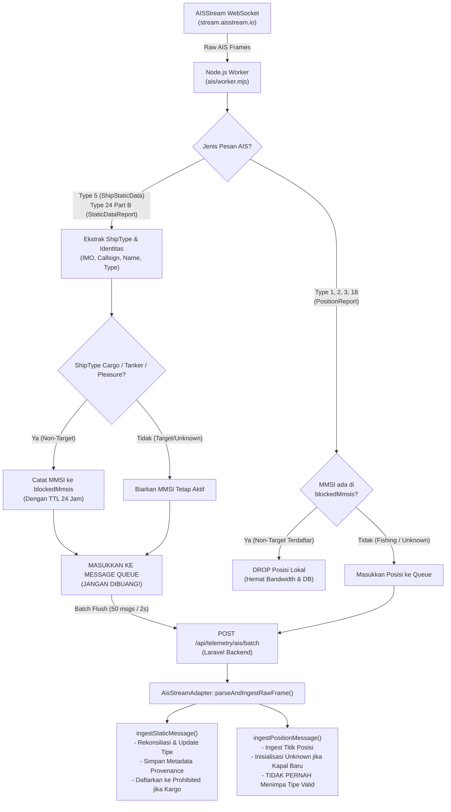

# RANCANGAN TEKNIS IMPLEMENTASI: PENYEMPURNAAN AIS INGESTION, KLASIFIKASI, DAN RETENSI (TAHAP 3)
## Global Fishing Vessel Monitoring Platform (GFVIP)

**Dokumen Desain Teknis:** `AIS_CLASSIFICATION_AND_RETENTION_IMPLEMENTATION_PLAN.md`  
**Status Desain:** Final Architecture Plan (Ready for Phase 4 Implementation)  
**Metode:** Read-Only Analysis & Precision Engineering Design  
**Dasar Audit:**  
1. `VESSEL_IDENTITY_AND_UNKNOWN_SHIPTYPE_AUDIT_REPORT.md` (Audit Tahap 1)  
2. `AIS_WORKER_PRODUCTION_VERIFICATION_REPORT.md` (Audit Tahap 2)

---

## 1. RINGKASAN AKAR MASALAH

Berdasarkan audit forensik pada Tahap 1 dan Tahap 2, akar masalah kemunculan kapal berstatus `VESSEL TYPE: Unknown` di production serta ketidaksesuaian data historis bermula dari 3 titik kegagalan (*failure points*):

```
┌────────────────────────────────────────────────────────────────────────────────────────┐
│                        TIGA AKAR MASALAH TEKNIS UTAMA                                  │
└────────────────────────────────────────────────────────────────────────────────────────┘

 1. ASINKRONISASI TRANSMISI AIS
    Paket posisi (PositionReport / Type 1, 2, 3, 18) TIDAK MEMILIKI field ShipType/IMO/Callsign.
    Paket statis (ShipStaticData / Type 5 & StaticDataReport / Type 24B) hanya dipancarkan tiap 6 menit.
    -> Saat kapal baru terdeteksi pertama kali, selalu diinisialisasi sebagai 'Unknown'.

 2. CELAH FILTER DROP LOKAL WORKER (ais/worker.mjs:268-296)
    Saat kapal kargo baru muncul:
    a) Posisi pertamanya lolos ke Laravel -> Tercatat di DB sebagai 'Unknown'.
    b) Beberapa menit kemudian paket statis Type 5 (ShipType=70) tiba di worker.
    c) Worker mendeteksi Cargo -> Menambahkan MMSI ke blockedMmsis dan MEMBUANG (DROP) paket tersebut.
    d) Laravel TIDAK PERNAH menerima paket statis tersebut!
    -> Status 'Unknown' pada kapal kargo tersebut TERTINGGAL SELAMANYA di database.

 3. WARISAN BUG FALLBACK LAMA PADA AISSTREAMADAPTER
    Sebelum commit e09a57e, baris kode ingestPositionMessage memuat:
    'vessel_type' => $message['ship_type'] ?? 'fishing'
    -> 5 kapal historis (termasuk kapal kontainer MAERSK MONTE VERDE dan kapal pandu WESERLOTSE)
       terlanjur terlabeli sebagai 'fishing' tanpa bukti ShipType 30 dari AIS.
```

---

## 2. ARSITEKTUR INGESTION TERPADU (PROPOSED ARCHITECTURE)

Arsitektur baru memisahkan secara tegas antara **Pembaruan Identitas Statis** (yang harus selalu sampai ke backend) dan **Pembatasan Frekuensi Posisi** (yang dapat dibatasi di worker untuk menghemat bandwidth dan kapasitas).



---

## 3. PERBAIKAN AIS WORKER (`ais/worker.mjs`)

### A. Lokasi dan Kode Saat Ini
File: [`ais/worker.mjs`](file:///c:/XPROJECT/global-fishing-vessel-intelligence/ais/worker.mjs)  
Baris: 260–297

```javascript
// KODE SAAT INI (BERMASALAH - MEMBUANG PAKET STATIS DINI):
if (msgType === 'ShipStaticData') {
    const staticData = messageObj.ShipStaticData || {};
    const shipType = staticData.Type;
    if (isProhibitedShipType(shipType)) {
        if (mmsi) blockedMmsis.add(mmsi);
        totalFilteredOut++;
        return; // <-- BUG: Membuang paket statis sehingga backend tidak pernah tahu tipe kapal!
    }
} else if (msgType === 'StaticDataReport') {
    const staticReport = messageObj.StaticDataReport || {};
    const shipType = staticReport.ReportB?.ShipType;
    if (isProhibitedShipType(shipType)) {
        if (mmsi) blockedMmsis.add(mmsi);
        totalFilteredOut++;
        return; // <-- BUG: Membuang paket statis!
    }
}
```

### B. Rancangan Perbaikan yang Aman
1. **Aturan Penanganan Paket Statis:**
   - Ketika `ShipStaticData` (Type 5) atau `StaticDataReport` (Type 24 Part B) tiba:
     - Ekstrak `mmsi` dan `shipType`.
     - Jika `isProhibitedShipType(shipType)` bernilai `true`:
       - Tambahkan `mmsi` ke `blockedMmsis` (agar posisi Type 1/2/3 berikutnya diblokir).
       - **JANGAN DI-RETURN!** Lanjutkan eksekusi ke `messageQueue.push(json)`.
     - Paket statis **HARUS MASUK ANTRIAN** ke Laravel backend minimal 1 kali agar backend dapat memperbarui field `vessel_type`, mencatat IMO/Callsign, dan mendaftarkannya ke tabel `prohibited_vessels`.
2. **Aturan Penanganan Type 24 Part A:**
   - `StaticDataReport` Part A hanya memuat nama kapal (`staticReport.ReportA.Name`), tidak memiliki `ShipType`.
   - Kode harus memastikan Part A tidak dievaluasi oleh `isProhibitedShipType()` dan tidak dianggap memiliki ShipType.
3. **Penyempurnaan Struktur `blockedMmsis` (TTL & Memory Leak Guard):**
   - Ubah `blockedMmsis` dari `Set()` biasa menjadi `Map<mmsi, expireTimestamp>`:
     - TTL default: **24 Jam** (`86400000 ms`).
     - Alasan: Menghindari pemblokiran permanen jika di kemudian hari sebuah MMSI dialokasikan ulang oleh otoritas maritim untuk kapal nelayan baru (*recycled MMSI*).
   - Kapasitas maksimum: 50.000 entri. Pembersihan otomatis entri kedaluwarsa dilakukan berkala setiap 1 jam via `setInterval()`.
4. **Resilience terhadap Restart Worker:**
   - Saat worker restart, worker membaca daftar blokir awal langsung dari API endpoint internal Laravel:
     `GET /api/telemetry/ais/prohibited-mmsis` (mengambil dari tabel `prohibited_vessels`).
   - Dengan sinkronisasi ini, MMSI kargo yang sudah teridentifikasi di database tidak akan lolos kembali meskipun worker di-restart.

---

## 4. PERBAIKAN SERVICE LAYER (`AisStreamAdapter.php`)

### A. Lokasi dan Kode Saat Ini
File: [`app/Services/Providers/AisStreamAdapter.php`](file:///c:/XPROJECT/global-fishing-vessel-intelligence/app/Services/Providers/AisStreamAdapter.php)  
Fungsi: `ingestStaticMessage()` (baris 872–1031)

```php
// KODE SAAT INI (CELAH METADATA PROVENANCE):
$rawShipType = $message['ship_type'] ?? null;
$vesselType = null;
$classificationSource = null; // <-- KOSONG (BUG)
$aisTypeCode = null;          // <-- KOSONG (BUG)

if ($rawShipType !== null && $rawShipType !== '') {
    $normalized = self::normalizeVesselType($rawShipType);
    if (in_array($normalized, ['cargo', 'tanker', 'pleasure'])) {
        \App\Models\ProhibitedVessel::firstOrCreate(...);
        return null; // <-- Menolak menyimpan kapal jika prohibited
    }
    $vesselType = $normalized;
}
```

### B. Rancangan Perbaikan yang Aman
1. **Rekonsiliasi Status Kapal yang Sudah Ada:**
   - Jika kapal sudah ada di basis data dengan status `vessel_type = 'unknown'`:
     - Saat paket statis tiba dengan tipe Cargo/Tanker/Pleasure:
       - Update `vessel_type` kapal eksisting menjadi `cargo`, `tanker`, atau `pleasure`.
       - Catat MMSI ke `prohibited_vessels`.
       - Rekam provenance: `classification_source = 'AIS_STATIC_MESSAGE_SHIPTYPE'`, `ais_type_code = $rawShipType`, `classified_at = now()`.
     - Dengan demikian, kapal tersebut tidak lagi berstatus `Unknown`!
2. **Inisialisasi Variabel Provenance:**
   - Pada baris 893–894:
     ```php
     $rawShipType = $message['ship_type'] ?? null;
     $vesselType = null;
     $classificationSource = ($rawShipType !== null && $rawShipType !== '') 
         ? 'AIS_STATIC_MESSAGE_SHIPTYPE' 
         : null;
     $aisTypeCode = ($rawShipType !== null && is_numeric($rawShipType)) 
         ? (int) $rawShipType 
         : null;
     ```
3. **Penyimpanan Persisten Timestamp Klasifikasi:**
   - Pada baris 978–983:
     Pastikan metadata array selalu tersimpan ke kolom `metadata` pada tabel `vessels`:
     ```php
     $meta = $vessel->metadata ?? [];
     $meta['classification_source'] = $classificationSource;
     $meta['ais_ship_type_code'] = $aisTypeCode;
     $meta['classified_at'] = $observedAt->toIso8601String();
     $updates['metadata'] = $meta;
     ```
4. **Proteksi Out-of-Order (Pesan Statis Terlambat):**
   - Jika pesan statis baru memiliki timestamp `observedAt` yang LEBIH TUA daripada `metadata['classified_at']` yang sudah ada, **TOLAK** penimpaan klasifikasi:
     ```php
     if (!empty($vessel->metadata['classified_at'])) {
         $existingTime = \Carbon\Carbon::parse($vessel->metadata['classified_at']);
         if ($observedAt->lt($existingTime)) {
             // Abaikan pembaruan tipe dari pesan usang
             $vesselType = null;
         }
     }
     ```

---

## 5. SKEMA METADATA PROVENANCE DAN AUDIT IDENTITAS

Setiap kapal wajib memiliki jejak rekam verifikasi (*provenance*) yang tersimpan dalam kolom `metadata` (format JSON) pada tabel `vessels`:

```json
{
  "classification_source": "AIS_STATIC_MESSAGE_SHIPTYPE",
  "ais_ship_type_code": 30,
  "classified_at": "2026-11-08T01:30:00+00:00",
  "verification_status": "verified",
  "raw_shiptype_label": "Fishing",
  "source_message_type": "ShipStaticData",
  "provenance_history": [
    {
      "event": "initial_creation",
      "vessel_type": "unknown",
      "timestamp": "2026-11-08T01:00:00+00:00",
      "reason": "Created from PositionReport without ShipType"
    },
    {
      "event": "type_resolved",
      "vessel_type": "fishing",
      "ais_ship_type_code": 30,
      "timestamp": "2026-11-08T01:30:00+00:00",
      "reason": "ShipStaticData received with ITU Type 30"
    }
  ]
}
```

---

## 6. PENANGANAN LIMA KAPAL HISTORIS (UNVERIFIED CLASSIFICATION CANDIDATES)

Kelima kapal yang teridentifikasi dalam audit Tahap 1 dan Tahap 2:
1. `WESERLOTSE` — MMSI: `211233660` (Pilot vessel / Kapal Pandu)
2. `XIN TAI YUAN` — MMSI: `311002359`
3. `MAERSK MONTE VERDE` — MMSI: `563051800` (Container Cargo ship)
4. `FRANKEN` — MMSI: `211443110`
5. `HANS` — MMSI: `232056936`

### Kebijakan Penanganan yang Aman & Legal:
1. **Prinsip Non-Destruktif:**
   - Jangan secara otomatis menghapus record kapal atau menghapus riwayat posisinya.
   - Jangan mengubah klasifikasi secara tebak-tebakan hanya berdasarkan nama kapal (misal kata "Maersk" atau "Lotse").
2. **Pemberian Status "Unverified Classification":**
   - Tandai kelima kapal ini pada basis data dengan atribut:
     `verification_status = 'unverified_historical'`
     `metadata->classification_verified = false`
     `metadata->verification_notes = 'Wariskan fallback lama tanpa bukti raw ShipType 30'`
3. **Mekanisme Review Administrator Terkontrol:**
   - Sediakan tombol dan antarmuka **Review Verifikasi Klasifikasi** pada menu `Vessel Detail` (`/vessels/{id}`) khusus peran Super Admin / Admin.
   - Administrator dapat melihat bukti raw payload yang ada, memeriksa data AISStream terbaru, dan secara eksplisit memilih:
     - **Konfirmasi sebagai Fishing** (jika ada bukti dokumen/perizinan sah).
     - **Revisi ke Tipe Sebenarnya** (misal Cargo / Pilot / Unknown) dengan menyertakan catatan review dan nomor referensi.
   - Seluruh tindakan dicatat ke tabel `audit_logs` dengan aksi `reclassify_vessel`.

---

## 7. RANCANGAN PERLINDUNGAN RETENSI (DATA RETENTION SAFEGUARD)

Menghubungkan status klasifikasi dengan engine `DataRetentionPolicyService`:

```
┌────────────────────────────────────────────────────────────────────────────────────────┐
│                        KEBIJAKAN RETENSI TERVALIDASI                                  │
└────────────────────────────────────────────────────────────────────────────────────────┘

 1. FISHING TERVERIFIKASI (verification_status = 'verified' & vessel_type = 'fishing')
    -> Kekebalan Mutlak: RETENSI PERMANEN (Zero Purge).

 2. FISHING BELUM TERVERIFIKASI (verification_status = 'unverified_historical')
    -> STATUS MASA TENGGANG (PROTEKSI SEMENTARA):
       Posisi TIDAK BOLEH DIHAPUS selama proses review administrator belum tuntas.
       Dikecualikan dari automatic purge berjadwal.

 3. NON-FISHING TERVERIFIKASI (Cargo, Tanker, Passenger, Tug, Pleasure, Other)
    -> Mengikuti durasi retensi terkonfigurasi (misal 90 hari).
    -> Hanya titik posisi kedaluwarsa yang dipangkas bertahap (batch chunk 1.000).

 4. UNKNOWN
    -> Mengikuti durasi retensi terpisah (default 30 hari).
    -> Jika dalam 30 hari kapal terbukti Fishing, otomatis naik status ke Fishing Permanen.

 5. BARANG BUKTI OPERASIONAL (SAR, Encounter, Investigasi, Compliance)
    -> Proteksi mutlak 100% tanpa batas waktu, terlepas dari tipe kapal.
```

Pada [`DataRetentionPolicyService.php`](file:///c:/XPROJECT/global-fishing-vessel-intelligence/app/Services/DataRetentionPolicyService.php#L210), kueri proteksi operational evidence disempurnakan dengan menambahkan kapal berstatus `unverified_historical` ke dalam daftar pengecualian:

```php
// Tambahkan proteksi untuk kapal fishing yang belum selesai direview
$unverifiedFishingIds = DB::table('vessels')
    ->where('vessel_type', 'fishing')
    ->where('verification_status', 'unverified_historical')
    ->pluck('id')
    ->toArray();

$protectedVesselIds = array_unique(array_merge($protectedVesselIds, $unverifiedFishingIds));
```

---

## 8. EVALUASI DAN RANCANGAN COMMAND REKONSILIASI

### Evaluasi Kebutuhan Command:
Apakah command Artisan `php artisan ais:reconcile-unverified-vessels` benar-benar diperlukan?
- **Analisis:** Sangat diperlukan sebagai instrumen CLI bagi System Administrator/DevOps untuk melakukan audit batch cepat di server tanpa harus membuka halaman web satu per satu, terutama saat proses maintenance terjadwal.
- **Batasan Command:** Command ini **TIDAK BOLEH MENEBAK** klasifikasi. Command hanya berfungsi sebagai:
  1. *Scanner*: Mendeteksi kapal yang `vessel_type = 'fishing'` tetapi raw payload-nya tidak memiliki ShipType 30.
  2. *Auditor*: Menampilkan perbandingan bukti AIS vs klasifikasi tersimpan.
  3. *Reporter*: Menghasilkan tabel audit identitas kapal.

### Signature dan Opsi Command:
```bash
php artisan ais:reconcile-unverified-vessels 
    {--dry-run : Tampilkan daftar kapal tanpa mengubah status apapun}
    {--mark-unverified : Beri label unverified_historical pada kapal tanpa bukti ShipType 30}
    {--mmsi= : Periksa kapal spesifik berdasarkan MMSI}
```

---

## 9. RENCANA PENGUJIAN OTOMATIS (14 TEST SCENARIOS)

File Test: `tests/Feature/AisClassificationAndRetentionSyncTest.php`

| No. | Skenario Pengujian | Hasil yang Diharapkan |
|:---:|---|---|
| 1 | `PositionReport` tiba sebelum `ShipStaticData` | Kapal baru dibuat dengan `vessel_type = 'unknown'`. Posisi tersimpan valid. |
| 2 | `ShipStaticData` Cargo (Type 70) tiba setelah kapal berstatus Unknown | Status kapal terupdate menjadi `cargo`, tercatat di `prohibited_vessels`, status `unknown` hilang. |
| 3 | `ShipStaticData` Fishing (Type 30) tiba setelah kapal berstatus Unknown | Status kapal terupdate menjadi `fishing`, status `verified`, mewarisi perlindungan permanen. |
| 4 | `StaticDataReport` Type 24 Part B membawa ShipType valid | Klasifikasi kapal diperbarui sesuai mapping ITU Part B. |
| 5 | `StaticDataReport` Type 24 Part A hanya membawa nama kapal | Nama kapal diperbarui, tetapi `vessel_type` tidak berubah dan tidak diasumsikan memiliki tipe. |
| 6 | Transponder memancarkan ShipType = 0 (*Not available*) | Kapal tetap berstatus `unknown`. |
| 7 | Pesan posisi periodik berikutnya tanpa ShipType tiba | Posisi baru disimpan, tetapi klasifikasi valid yang sudah tersimpan **TIDAK PERNAH** terhapus. |
| 8 | Pesan statis lama (*out-of-order*) tiba dengan timestamp lebih usang | Ditolak oleh guard `classified_at`; klasifikasi yang lebih baru tetap dipertahankan. |
| 9 | Worker restart / reset `blockedMmsis` | Worker mengambil kembali daftar blokir awal dari API Laravel sehingga kargo tetap terblokir. |
| 10 | Worker membatasi posisi kargo tanpa membuang pembaruan statis | Posisi berkecepatan tinggi kargo di-drop, tetapi paket statis identitas tetap diproses. |
| 11 | Kapal Fishing terverifikasi diuji terhadap purge | Posisi berusia >365 hari tetap 100% utuh di database (Zero Purge). |
| 12 | Kapal dengan klasifikasi `unverified_historical` diuji terhadap purge | Posisi dilindungi sementara dan tidak terhapus selama proses review. |
| 13 | Kapal kargo terkait barang bukti SAR / Encounter | Dikecualikan 100% dari retensi pembersihan meskipun batas retensi telah terlampaui. |
| 14 | Penyerapan batch gagal sementara (*network glitch*) | Antrean di-retry tanpa duplikasi record posisi (terlindungi *unique constraint*). |

---

## 10. DAFTAR FILE, FUNGSI, DAN ESTIMASI PERUBAHAN TAHAP 4

| File Target | Komponen / Fungsi | Deskripsi Perubahan |
|---|---|---|
| `ais/worker.mjs` | Filter Static Metadata (baris 268–296) | Izinkan frame statis kargo/tanker masuk ke `messageQueue` (hapus `return;` prematur); terapkan TTL 24 jam pada `blockedMmsis`. |
| `ais/worker.mjs` | Inisialisasi Startup (baris 80–120) | Ambil daftar MMSI terblokir dari backend saat start (`/api/telemetry/ais/prohibited-mmsis`). |
| `app/Services/Providers/AisStreamAdapter.php` | `ingestStaticMessage()` (baris 872–1031) | Update status kapal kargo eksisting dari `unknown`; inisialisasi `$classificationSource`, `$aisTypeCode`, dan `$meta['classified_at']`. |
| `app/Services/DataRetentionPolicyService.php` | `getCandidatePositionsQuery()` (baris 265–340) | Tambahkan proteksi masa tenggang (*temporary hold*) untuk kapal berstatus `unverified_historical`. |
| `app/Console/Commands/ReconcileUnverifiedVesselsCommand.php` | File Baru | Command CLI `ais:reconcile-unverified-vessels` untuk audit dan penandaan status verifikasi. |
| `routes/api.php` | Route Baru (baris 70–110) | Endpoint internal `GET /api/telemetry/ais/prohibited-mmsis` dengan autentikasi `X-AIS-Token`. |
| `tests/Feature/AisClassificationAndRetentionSyncTest.php` | File Baru | 14 test scenario otomatis memvalidasi seluruh alur ingestion, klasifikasi, dan retensi. |

---

## 11. ANALISIS RISIKO DAN MITIGASI

1. **Risiko 1: Beban Pengiriman Paket Statis ke Backend**
   - *Analisis:* Mengizinkan paket statis kargo/tanker dikirim ke Laravel akan sedikit meningkatkan request ke `/api/telemetry/ais/batch`.
   - *Mitigasi:* Paket statis hanya dipancarkan sekali per 6 menit per kapal. Volume paket statis kurang dari 1% dari total volume pesan AIS. Sistem micro-batching (50 pesan per flush) dapat menampungnya tanpa lonjakan beban.
2. **Risiko 2: Kesalahan Klasifikasi Manual oleh Administrator**
   - *Analisis:* Administrator dapat keliru merevisi kapal nelayan menjadi kapal non-fishing.
   - *Mitigasi:* Seluruh perubahan status verifikasi mewajibkan input alasan dan tercatat permanen pada tabel `audit_logs` bersama identitas user ID, IP address, dan timestamp.
3. **Risiko 3: Kehilangan Posisi Historis pada Kapal Nelayan Belum Terverifikasi**
   - *Analisis:* Jika status `fishing` dicabut terlalu cepat, posisi historis kapal nelayan dapat terkena purge retensi non-fishing.
   - *Mitigasi:* Aturan retensi memberikan proteksi mutlak (*freeze*) pada kapal `unverified_historical` sampai administrator membuat keputusan resmi.

---

## 12. URUTAN IMPLEMENTASI TAHAP 4

Ketika pengguna menyetujui peluncuran Tahap 4, langkah-langkah implementasi akan dieksekusi secara terstruktur:

1. **Langkah 1:** Tambahkan endpoint internal `GET /api/telemetry/ais/prohibited-mmsis` pada `routes/api.php` untuk melayani daftar blokir persisten.
2. **Langkah 2:** Perbaiki `ais/worker.mjs` (hapus *early drop* pada paket statis, implementasikan TTL 24 jam dan sinkronisasi startup).
3. **Langkah 3:** Sempurnakan `AisStreamAdapter.php` (`ingestStaticMessage()` mengupdate `unknown` menjadi tipe terdeteksi dan merekam metadata provenance lengkap).
4. **Langkah 4:** Perbarui `DataRetentionPolicyService.php` untuk melindungi kapal berstatus `unverified_historical` dari purge otomatis.
5. **Langkah 5:** Buat Artisan command `ReconcileUnverifiedVesselsCommand.php` (`ais:reconcile-unverified-vessels`).
6. **Langkah 6:** Tulis dan jalankan seluruh 14 skenario pengujian pada `AisClassificationAndRetentionSyncTest.php`.
7. **Langkah 7:** Jalankan verifikasi regresi penuh (`php artisan test`) dan kompilasi aset frontend (`npm run build`).
8. **Langkah 8:** Dokumentasikan laporan implementasi final, stage file yang relevan, commit git, dan push ke GitHub.

---

> [!IMPORTANT]
> **STATUS TAHAP 3 SELESAI:** Seluruh rancangan arsitektur teknis perbaikan telah selesai disusun dalam mode **READ-ONLY**. Tidak ada baris kode atau data yang diubah.  
> 
> **Pekerjaan dihentikan di sini. Menunggu persetujuan Anda sebelum melangkah ke Tahap 4 — Implementasi Perbaikan.**

