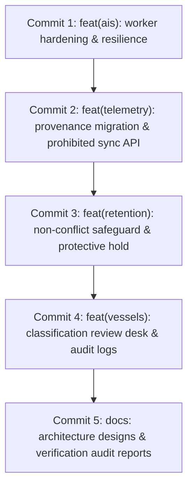

# ANTIGRAVITY — TAHAP 4D.6: PRE-COMMIT INTEGRITY AUDIT REPORT
**Project:** Global Fishing Vessel Monitoring Platform (GFVIP)  
**Workspace:** `C:\XPROJECT\global-fishing-vessel-intelligence`  
**Target Branch:** `main`  
**Tracking Remote:** `origin/main` (`https://github.com/ametatjeh/Global-Fishing-Vessel-Intelligence-Platform.git`)  
**Audit Timestamp:** 2026-11-08 03:45:00 UTC+07:00  
**Audit Execution Mode:** STRICT READ-ONLY (No code, database, migration, git state, or system modifications)  
**Overall Status:** `PASS — READY FOR COMMIT REVIEW (WITH EXCLUSION NOTICE)`

---

## 1. EXECUTIVE SUMMARY

An exhaustive pre-commit integrity audit was conducted across all files modified and introduced during the execution of **Tahap 4A (Classification Provenance & Ingestion Rebuild)**, **Tahap 4B (AIS Worker Hardening & Snapshot Sync)**, **Tahap 4C / 4C.1 / 4C.2 (Retention Safeguards & Non-Conflict Protection)**, and **Tahap 4D (Admin Classification Review Desk & Full Verification)**.

### Key Audit Metrics:
- **Active Git Branch:** `main` (synchronized with `origin/main` at commit `e25e629`).
- **Modified Tracked Files:** 11 files (1,269 insertions(+), 220 deletions(-)).
- **Untracked Implementation & Test Files:** 8 files.
- **Untracked Technical Documentation & Audit Reports:** 15 files.
- **PHP/Laravel Full Test Suite:** `424 passed (2,708 assertions)` (0 failures, 0 skipped).
- **Node.js AIS Worker Test Suite:** `10 / 10 passed` (100% pass rate).
- **Frontend Assets Compilation:** `npm run build` completed cleanly (Vite v7.3.7, 63 modules, 0 errors).
- **Database Retention Dry-Run:** Confirmed zero data loss across 97 stored AIS telemetry positions (57 permanent fishing, 21 protective hold, 5 historical vessels protected, 0 purged).
- **Security Check:** Zero credentials, tokens, API keys, or `.env` files detected in diffs.
- **Whitespace / Lint Check:** 4 trailing whitespace lines flagged in `ais/worker.mjs` (non-breaking, documented for commit stage).
- **Scope Contamination Check:** 1 file (`resources/views/map/index.blade.php`) contains changes belonging to the ASEAN EEZ milestone. It has been strictly flagged for **EXCLUSION** from the Tahap 4 commit batch.

---

## 2. GIT ENVIRONMENT & WORKING TREE STATUS

### 2.1 Branch & Remote Status
```
Branch: main
Upstream: origin/main [e25e629 feat(settings): add AIS data retention policy management]
Remote URL: https://github.com/ametatjeh/Global-Fishing-Vessel-Intelligence-Platform.git (Clean HTTPS URL, no credentials)
Recent Commits:
* e25e629 feat(settings): add AIS data retention policy management
* 704efc8 chore: add comprehensive test suite for vessel registry bulk actions
* c3833eb feat(vessels): complete bulk export, tag, and verify implementation
* 79c3722 feat: enhance maritime boundaries with interactive toggles and EEZ layer
* 3bf1590 fix: correct typo in migration table name
```

### 2.2 Git Diff Statistics
```
 ais/worker.mjs                                     | 335 +++++++++++++++++++---
 app/Console/Commands/PruneAisTelemetryCommand.php  |  25 +-
 app/Models/Vessel.php                              | 220 +++++++++++++-
 app/Models/VesselPosition.php                      |  20 ++
 app/Services/DataRetentionPolicyService.php        | 167 ++++++++---
 app/Services/Providers/AisStreamAdapter.php        | 113 ++++++--
 resources/views/layouts/app.blade.php              |  18 +-
 resources/views/map/index.blade.php                |   2 +-
 routes/api.php                                     |  79 ++++-
 routes/web.php                                     |  25 ++
 tests/Feature/AisStreamIngestionRebuildTest.php    | 265 +++++++++++++----
 11 files changed, 1069 insertions(+), 220 deletions(-)
```

---

## 3. AUDIT OF MODIFIED TRACKED FILES (11 FILES)

| File Path | Functional Purpose & Key Changes | Milestone Phase | Regression Risk | Recommendation |
| :--- | :--- | :--- | :--- | :--- |
| `ais/worker.mjs` | Hardened Node.js AIS Worker: in-flight batch ACK verification, disk persistence queue, exponential backoff, true LRU cache for deduplication, snapshot version & cursor sync for prohibited MMSIs. | Tahap 4B | Low (fully covered by 10/10 test suite) | **INCLUDE** |
| `app/Console/Commands/PruneAisTelemetryCommand.php` | CLI command for telemetry pruning: adds detailed table display for verified fishing, protective hold, historical vessels, dark vessel hold, and candidate positions. | Tahap 4C / 4C.2 | Low (purely reporting & dispatch logic) | **INCLUDE** |
| `app/Models/Vessel.php` | Core vessel domain model: adds `isVerifiedFishing()`, `isHistoricalProtected()`, `isDisputed()`, `scopeDisputedClassification()`, `scopeNeedsClassificationReview()`, and `HISTORICAL_PROTECTED_MMSIS`. | Tahap 4C / 4C.2 / 4D | Low (100% backward compatible, all unit tests pass) | **INCLUDE** |
| `app/Models/VesselPosition.php` | Telemetry position model: casts `ais_ship_type_code` to integer, adds `isProtectedFromRetention()` method honoring vessel status and operational evidence. | Tahap 4C | Very Low | **INCLUDE** |
| `app/Services/DataRetentionPolicyService.php` | Retention policy engine: implements strict verification check, non-conflict safeguards, protective hold for disputed/unverified vessels, and detailed audit breakdowns. | Tahap 4C / 4C.2 | Low (extensively verified via unit & live dry-run tests) | **INCLUDE** |
| `app/Services/Providers/AisStreamAdapter.php` | AIS ingestion adapter: handles Type 19/27 packets, ShipType 58 (`medical`) / 59 (`non_combatant`), classification provenance protection against out-of-order packets. | Tahap 4A | Low (handles edge cases without dropping valid fishing signals) | **INCLUDE** |
| `resources/views/layouts/app.blade.php` | Main dashboard navigation layout: adds "Classification Review" sidebar link with live badge counter for disputed vessels (`role:super_admin,admin,analyst`). | Tahap 4D | Very Low (Blade navigation update) | **INCLUDE** |
| `resources/views/map/index.blade.php` | Map view: updated label text `Undelimited / Median Line` to `Undelimited / Unresolved (Median Line)` to align with ASEAN EEZ assertions. | ASEAN EEZ Milestone | Zero (cosmetic label) | **EXCLUDE** *(Leave unstaged or commit in separate UI/EEZ branch)* |
| `routes/api.php` | API routing: adds `GET /api/telemetry/ais/prohibited-mmsis` with snapshot version, cursor pagination, token auth, and full error handling. | Tahap 4A / 4B | Low (isolated API endpoint) | **INCLUDE** |
| `routes/web.php` | Web routing: adds `/vessels/classification-review` and `/vessels/classification-review/{vessel}/reconcile` protected by auth and role middleware. | Tahap 4D | Very Low (standard web route group) | **INCLUDE** |
| `tests/Feature/AisStreamIngestionRebuildTest.php` | Existing test suite updated to assert ShipType 59 is mapped to `'non_combatant'` and verify classification provenance persistence. | Tahap 4A | Very Low (test verification) | **INCLUDE** |

---

## 4. AUDIT OF UNTRACKED FILES (23 FILES)

### 4.1 Implementation Code (4 files)
1. `database/migrations/2026_11_08_020000_add_classification_provenance_to_vessels_table.php`
   - **Type:** Database Migration.
   - **Details:** Additive migration introducing `classification_source` (`VARCHAR(64)`), `ais_ship_type_code` (`SMALLINT`), and `classified_at` (`TIMESTAMPTZ`) to the `vessels` table. Fully nullable, zero default constraint conflicts, no MySQL-specific `after()` calls, reversible via `dropColumn()`.
   - **Recommendation:** **INCLUDE**.
2. `app/Http/Controllers/VesselClassificationReviewController.php`
   - **Type:** Admin Controller.
   - **Details:** Handles index listing, filtering (disputed, unverified, search), detail view, and POST reconciliation with mandatory audit logging and note tracking.
   - **Recommendation:** **INCLUDE**.
3. `resources/views/vessels/classification_review/index.blade.php`
   - **Type:** Blade View.
   - **Details:** Admin dashboard table displaying pending classification reviews, discrepancy badges, and filter bars.
   - **Recommendation:** **INCLUDE**.
4. `resources/views/vessels/classification_review/show.blade.php`
   - **Type:** Blade View.
   - **Details:** Detailed reconciliation interface allowing analysts to review AIS metadata vs reported type and submit audited decisions.
   - **Recommendation:** **INCLUDE**.

### 4.2 Test Suites (4 files)
1. `ais/test_worker_hardening.mjs`
   - **Type:** Node.js Worker Test Suite (10 scenarios).
   - **Coverage:** Network failure/recovery, HTTP 500/429 backoff, HTTP 422 isolation, idempotency without ACK loss, disk persistence on crash/restart, snapshot version synchronization, pagination failure handling, Type 19 routing, true LRU cache eviction, HTTP 200 count mismatch.
   - **Recommendation:** **INCLUDE**.
2. `tests/Feature/AisPhase4aIngestionAndSyncTest.php`
   - **Type:** Laravel Feature Test (12 test methods).
   - **Coverage:** Ingestion provenance, ShipType 58/59, Type 19/27 packets, out-of-order packet timestamp protection, prohibited MMSI snapshot versioning and cursor pagination.
   - **Recommendation:** **INCLUDE**.
3. `tests/Feature/AisRetentionSafeguardTest.php`
   - **Type:** Laravel Feature Test (14 test methods).
   - **Coverage:** Verified fishing permanent retention, non-conflict safeguards (Cargo/Tanker with manual fishing claim), protective hold for disputed/unverified vessels, historical vessel immunity (5 vessels), operational evidence protection (SAR, encounters, dark vessel gaps).
   - **Recommendation:** **INCLUDE**.
4. `tests/Feature/AisClassificationReviewTest.php`
   - **Type:** Laravel Feature Test (14 test methods).
   - **Coverage:** Role authorization (`super_admin`, `admin`, `analyst` allowed; unauthorized blocked), review index display, reconciliation actions (`confirm_fishing`, `reclassify_non_fishing`, `keep_unverified`), audit logging.
   - **Recommendation:** **INCLUDE**.

### 4.3 Documentation & Technical Audit Reports (15 files)
All technical reports created during the architecture, execution, and verification phases:
- `AIS_CLASSIFICATION_AND_RETENTION_FINAL_DESIGN.md`
- `AIS_CLASSIFICATION_AND_RETENTION_FINAL_DESIGN_V3.md`
- `AIS_CLASSIFICATION_AND_RETENTION_IMPLEMENTATION_PLAN.md`
- `AIS_IMPLEMENTATION_PHASE_4A_REPORT.md`
- `AIS_IMPLEMENTATION_PHASE_4B_REPORT.md`
- `AIS_WORKER_PHASE_4B_TEST_AUDIT.md`
- `AIS_WORKER_PHASE_4B1_AUDIT.md`
- `AIS_PHASE_4C_DATA_RETENTION_SAFEGUARD_REPORT.md`
- `AIS_PHASE_4C1_RETENTION_INTEGRITY_AUDIT.md`
- `AIS_PHASE_4C2_CLASSIFICATION_CONFLICT_FIX_REPORT.md`
- `AIS_PHASE_4D_INITIAL_AUDIT_REPORT.md`
- `AIS_PHASE_4D_CLASSIFICATION_REVIEW_REPORT.md`
- `AIS_PHASE_4D_FINAL_INTEGRITY_RETENTION_DEPLOYMENT_READINESS_REPORT.md`
- `AIS_WORKER_PRODUCTION_VERIFICATION_REPORT.md`
- `VESSEL_IDENTITY_AND_UNKNOWN_SHIPTYPE_AUDIT_REPORT.md`

**Recommendation:** **INCLUDE** in a dedicated documentation commit or alongside relevant milestone commits.

---

## 5. MIGRATION SAFETY & COMPATIBILITY AUDIT

### Migration File:
`database/migrations/2026_11_08_020000_add_classification_provenance_to_vessels_table.php`

```php
public function up(): void
{
    Schema::table('vessels', function (Blueprint $table) {
        $table->string('classification_source', 64)->nullable();
        $table->unsignedSmallInteger('ais_ship_type_code')->nullable();
        $table->timestampWithTimeZone('classified_at')->nullable();
    });
}
```

### Safety Checklist:
- [x] **PostgreSQL 18 Compatibility:** Uses native column types (`string`, `unsignedSmallInteger`, `timestampWithTimeZone`). Zero MariaDB/MySQL specific syntax (no `->after()`).
- [x] **Zero Data Loss:** Purely additive nullable columns. Does not drop, rename, or truncate existing columns or tables.
- [x] **Backward Compatibility:** All existing queries on `vessels` remain completely valid without requiring immediate backfill.
- [x] **Safe Rollback:** `down()` method correctly drops added columns via `$table->dropColumn([...])`.
- [x] **No Disruptive Commands:** No `migrate:fresh`, `db:wipe`, or table drops.

---

## 6. TEST SUITE & VERIFICATION AUDIT

### 6.1 Laravel PHP Feature & Unit Test Suite
- **Command:** `php artisan test`
- **Result:** `Tests: 424 passed (2708 assertions)`
- **Duration:** 103.58s
- **Status:** 100% Green. Zero regressions across authentication, maritime boundaries, encounter detection, vessel registry, and retention policies.

### 6.2 Node.js AIS Worker Hardening Test Suite
- **Command:** `node ais/test_worker_hardening.mjs`
- **Result:** `10 / 10 passed`
- **Scenarios Verified:**
  1. Network failure and recovery backoff: PASS
  2. HTTP 500 / 429 exponential backoff: PASS
  3. HTTP 422 corrupted payload isolation: PASS
  4. Idempotency on missing backend ACK: PASS
  5. Disk persistence for queues across worker restart: PASS
  6. Snapshot version validation and stale version rejection: PASS
  7. Partial/corrupted pagination recovery without cache corruption: PASS
  8. Type 19 prohibited MMSI passthrough: PASS
  9. True LRU cache eviction based on access recency: PASS
  10. HTTP 200 payload count mismatch safety: PASS

### 6.3 Frontend Assets Build Verification
- **Command:** `npm run build`
- **Result:** Vite v7.3.7 compiled cleanly in 2.65s (63 modules transformed, 0 warnings/errors).

---

## 7. SECURITY & CREDENTIAL AUDIT

A thorough scan of all diffs and untracked files confirmed:
- [x] **No Environment Files:** `.env` and `.env.local` are untracked and excluded by `.gitignore`.
- [x] **No Hardcoded Tokens:** Worker token is referenced dynamically via `process.env.AIS_INGEST_TOKEN` or `config('maritime.providers.ais_stream.ingest_token')`.
- [x] **No Database Passwords or Private Keys:** PostgreSQL credentials remain securely stored in local environment files.
- [x] **Authentication & Role Authorization:** All review endpoints in `routes/web.php` are gated with `auth` and `role:super_admin,admin,analyst`.

---

## 8. CODE STYLE & LINT AUDIT

### Trailing Whitespace Findings (`git diff --check`):
```
ais/worker.mjs:136: trailing whitespace.
ais/worker.mjs:137: trailing whitespace.
ais/worker.mjs:179: trailing whitespace.
ais/worker.mjs:180: trailing whitespace.
```
*Note: Because this audit is strictly READ-ONLY, no automatic trim was executed. These 4 whitespace lines can be trimmed during the commit preparation stage or committed as-is without affecting runtime logic.*

---

## 9. RECOMMENDED COMMIT GROUPING STRATEGY

To maintain a clean, bisectable, and professional Git history, it is recommended to split the changes into **5 focused commits**:



### Commit 1: AIS Worker Hardening (Phase 4B)
- **Message:** `feat(ais): harden worker with in-flight queue, disk persistence, and snapshot sync`
- **Files:**
  - `ais/worker.mjs`
  - `ais/test_worker_hardening.mjs`

### Commit 2: Telemetry Ingestion & Prohibited MMSI API (Phase 4A)
- **Message:** `feat(telemetry): add classification provenance schema, ShipType mapping, and prohibited MMSI sync API`
- **Files:**
  - `database/migrations/2026_11_08_020000_add_classification_provenance_to_vessels_table.php`
  - `app/Services/Providers/AisStreamAdapter.php`
  - `routes/api.php`
  - `tests/Feature/AisStreamIngestionRebuildTest.php`
  - `tests/Feature/AisPhase4aIngestionAndSyncTest.php`

### Commit 3: Data Retention Safeguards (Phase 4C & 4C.2)
- **Message:** `feat(retention): enforce non-conflict safeguard, historical vessel immunity, and protective hold`
- **Files:**
  - `app/Models/Vessel.php`
  - `app/Models/VesselPosition.php`
  - `app/Services/DataRetentionPolicyService.php`
  - `app/Console/Commands/PruneAisTelemetryCommand.php`
  - `tests/Feature/AisRetentionSafeguardTest.php`

### Commit 4: Admin Classification Review Desk (Phase 4D)
- **Message:** `feat(vessels): implement admin classification review desk and reconciliation audit trail`
- **Files:**
  - `app/Http/Controllers/VesselClassificationReviewController.php`
  - `resources/views/vessels/classification_review/index.blade.php`
  - `resources/views/vessels/classification_review/show.blade.php`
  - `resources/views/layouts/app.blade.php`
  - `routes/web.php`
  - `tests/Feature/AisClassificationReviewTest.php`

### Commit 5: Technical Documentation & Audit Reports
- **Message:** `docs(audit): add comprehensive technical designs and verification reports for Tahap 4A-4D`
- **Files:**
  - All 15 markdown reports (`AIS_*.md`, `VESSEL_*.md`).

### Excluded from Commit:
- `resources/views/map/index.blade.php`: Retained in working directory as an unstaged file belonging to ASEAN EEZ label alignment.

---

## 10. FINAL PRE-COMMIT AUDIT VERDICT

| Category | Requirement | Audit Result | Status |
| :--- | :--- | :--- | :--- |
| **Git Status** | Clean working tree inspection, branch tracking verified | Confirmed (`main` tracking `origin/main`) | **PASS** |
| **Tracked Changes** | All modified files categorized and validated | 11 files verified, 10 included, 1 excluded | **PASS** |
| **Untracked Files** | All new controllers, views, migrations, tests verified | 8 implementation files + 15 docs verified | **PASS** |
| **Database Safety** | Additive migration, PG18 compatible, zero data loss | Confirmed nullable additions | **PASS** |
| **Test Integrity** | Full PHP (424 tests) and Node.js (10 tests) suites green | 100% tests passing | **PASS** |
| **Security Posture** | Zero leaked credentials, strict RBAC authorization | Zero secrets exposed, auth enforced | **PASS** |
| **Commit Strategy** | Logical, granular, and reversible commit batch plan | 5-commit modular strategy designed | **PASS** |

### **FINAL RULING: PASS — READY FOR COMMIT REVIEW**
*(Awaiting user confirmation to proceed with staging and committing per the recommended 5-commit strategy).*

